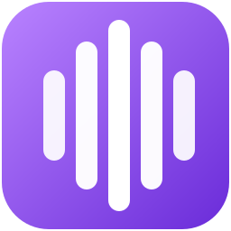

<div align="center">



# LoopbackTranscriber

**Record, transcribe and summarize your meetings without anything leaving your computer.**

<p>
  
  
  
  
  
  
  
  
  <a href="LICENSE">
    
  </a>
</p>

<a href="https://pgomur.github.io/loopback-transcriber/en/"><b>Documentation</b></a>
&nbsp;·&nbsp;
<a href="https://pgomur.github.io/loopback-transcriber/es/"><b>Documentación en español</b></a>

<a href="#features">Features</a>
&nbsp;•&nbsp;
<a href="#how-it-works">How it works</a>
&nbsp;•&nbsp;
<a href="#getting-started">Getting started</a>
&nbsp;•&nbsp;
<a href="#privacy-and-data">Privacy and data</a>
&nbsp;•&nbsp;
<a href="#architecture">Architecture</a>
&nbsp;•&nbsp;
<a href="#building-from-source">Building from source</a>
&nbsp;•&nbsp;
<a href="#project-structure">Project structure</a>
&nbsp;•&nbsp;
<a href="#documentation">Documentation</a>
&nbsp;•&nbsp;
<a href="#credits">Credits</a>

</div>

<br>

LoopbackTranscriber is a Windows desktop application. It records the audio of **one specific application** (Teams, Zoom, Meet in the browser…) together with your microphone, transcribes it with **Whisper**, tells what you say apart from what the others say and, when you ask for it, writes a summary with **Qwen3-4B**. While you record, it can also show the meeting **translated live** in a floating window.

Everything runs on your computer. The internet is only used to download the two models.

## Features

<table>
  <tr>
    <td width="50%" valign="top">
      <b>Per-application recording</b><br>
      Only the audio of the chosen program, plus your microphone on a separate track. If the application track turns out silent, the default audio output is used instead.
    </td>
    <td width="50%" valign="top">
      <b>Any application</b><br>
      Teams is built in. Zoom, Discord or the browser (for Meet) can be added from the processes that are playing audio.
    </td>
  </tr>
  <tr>
    <td valign="top">
      <b>Transcription with Whisper</b><br>
      Whisper <code>large-v3-turbo</code>, on a Vulkan GPU when there is one. Fixed language or automatic detection. Hallucinations, repetitions and echo are filtered out.
    </td>
    <td valign="top">
      <b>Who is speaking</b><br>
      Your microphone is transcribed separately and aligned with the meeting. Each paragraph is labelled <b>Participants</b> or <b>You</b>, with your name in front if you set one.
    </td>
  </tr>
  <tr>
    <td valign="top">
      <b>History and search</b><br>
      Search the title, application, date, summary and full text, ignoring case and accents. Filter by date and duration, and transcribe again with the current settings.
    </td>
    <td valign="top">
      <b>AI summary</b><br>
      Qwen3-4B writes a title, purpose, key points, topics, goals and next steps, in the application language.
    </td>
  </tr>
  <tr>
    <td valign="top">
      <b>Live translation</b><br>
      A floating window with what the participants say and its translation into Spanish, English, Portuguese, German or Russian.
    </td>
    <td valign="top">
      <b>Nothing is lost</b><br>
      After an error, an exit, a shutdown or a crash, the audio is kept as an unprocessed recording so it can be retried.
    </td>
  </tr>
</table>

The interface, the meeting language and the translation are available in **Spanish, English, Portuguese, German and Russian**. The meeting language can also be detected automatically.

## How it works

1. **Capture.** The application is recorded with Windows *process loopback*, so only its audio is captured. The default audio output and the microphone are recorded at the same time on separate tracks.
2. **Preparation.** The tracks are converted to 16 kHz mono, and a noise gate silences the microphone between your words.
3. **Transcription.** Whisper transcribes both tracks in a separate worker process, which exits when done to free the native and GPU memory.
4. **Composition.** Your microphone is aligned with the meeting, sentences picked up by both tracks (speakers into the mic, or your voice played back by the application) are kept only once, and each paragraph gets its speaker label.
5. **Summary.** On demand, Qwen3-4B summarizes the transcript, also in its own worker process.

## Getting started

### Requirements

| Item | Requirement |
|---|---|
| System | 64-bit Windows 11 (10.0.22000 or later) |
| Acceleration | A Vulkan GPU when there is one; otherwise the CPU (slower) |
| Runtime | Microsoft Visual C++ Redistributable (x64), added by the installer if it is missing |
| Disk | About 3.1 GB for the two models |

| Model | Used for | Size |
|---|---|---|
| Whisper large-v3-turbo (GGML, q5_1) | Transcription and live transcription | ~624 MB |
| Qwen3-4B (GGUF, Q4_K_M) | Summaries and live translation | ~2.5 GB |

### Installation

1. Run `LoopbackTranscriberSetup-<version>.exe`. The wizard is available in Spanish, English, Portuguese, German and Russian.
2. On the first start, the **Before you start** screen downloads both models. Each download can be paused, resumed or cancelled, and its SHA256 checksum is verified when it finishes.
3. In **Settings**, check your name, the meeting language and the application language.

Only one instance can run at a time: opening it again shows the window of the one already running.

### Usage

1. **Pick the application.** Teams is built in; others are added in **Applications**.
2. **Record.** Press **Start recording**, or use the tray icon.
3. **Get the transcript.** Press **Stop recording**. Whisper transcribes it and, if your microphone was recorded, separates **Participants** from **You**. It is saved in the history.
4. **Summarize.** In the **AI summary** tab, press **Summarize**.

Optionally, open **live translation** to follow the meeting translated while you record. Full walkthrough in the [user guide](https://pgomur.github.io/loopback-transcriber/en/guide/getting-started.html).

## Privacy and data

Audio, transcripts and summaries never leave your computer. The application only goes online to download the models, from a fixed Hugging Face revision and with their SHA256 checked. The installer may also download the Visual C++ Redistributable if it is missing.

```text
%LocalAppData%\LoopbackTranscriber\
├── settings.json
├── models\            Whisper and Qwen3-4B (configurable)
├── transcripts\       One folder per application and per recording (configurable)
├── failed\            Unprocessed recordings, kept to be retried
└── logs\app.log
```

Each recording is a folder `transcripts\<App>\<App>_<yyyyMMdd_HHmmss>\`:

| File | Contents | When it exists |
|---|---|---|
| `<base>.md` | The transcript, in Markdown | Always |
| `<base>.wav` | The main audio track | Always |
| `<base>_mic.wav` | Your microphone track | If the microphone was recorded |
| `<base>.recording.json` | The microphone offset | If there is a `_mic.wav` |
| `<base>.summary.json` | The summary | If one was generated |

> [!IMPORTANT]
> Only record and transcribe with the consent of the people taking part. You are responsible for informing them and for complying with the law in your country.

## Architecture

A single WPF project following **MVVM** with CommunityToolkit.Mvvm and a Microsoft.Extensions.DependencyInjection container.

| Layer | Contents |
|---|---|
| Views | XAML and code-behind: main window, tray menu, floating translation window |
| ViewModels | State and commands of each screen; they talk to each other through messages |
| Services | Capture, processing, transcription, summary, live session, persistence, localization and logging |
| Interop | WASAPI COM interfaces, process loopback activation, audio sessions and the process tree |

Design principles:

- **Nothing leaves the computer.** The only network access is downloading the models.
- **No audio is lost.** A recording that cannot be transcribed is kept to be retried, even if the application closes, hangs or the computer shuts down.
- **Inference runs in separate processes.** Each transcription and each summary runs in a child process, so the application stays light while it waits in the tray.
- **Services do not depend on WPF.** The system dependencies sit behind interfaces, so the logic is tested without a window, audio devices or models.

| Package | Version | Used for |
|---|---|---|
| CommunityToolkit.Mvvm | 8.4.2 | Observable properties, commands and messaging |
| Microsoft.Extensions.DependencyInjection | 10.0.0 | Service container |
| WPF-UI | 4.3.0 | Dark theme, accent color and Fluent controls |
| NAudio | 2.2.1 | Device and microphone capture; WAV reading, writing and conversion |
| Whisper.net (+ Runtime, Runtime.Vulkan) | 1.9.1 | Speech recognition on the CPU or on a Vulkan GPU |
| LLamaSharp (+ Backend.Cpu, Backend.Vulkan) | 0.27.0 | Summaries and translation with Qwen3-4B |

More in [Architecture](https://pgomur.github.io/loopback-transcriber/en/architecture/overview.html).

## Building from source

Requires 64-bit Windows 11 and the **.NET 10 SDK**. Visual Studio is optional.

```powershell
dotnet build LoopbackTranscriber.slnx -c Release
dotnet test  LoopbackTranscriber.slnx -c Release
dotnet publish LoopbackTranscriber\LoopbackTranscriber.csproj -p:PublishProfile=FolderProfile
```

Publishing writes a self-contained `win-x64` build to `installer\publish\`. The installer is compiled with **Inno Setup 6.3** or later and is written to `installer\Output\LoopbackTranscriberSetup-<version>.exe`:

```powershell
ISCC.exe installer\LoopbackTranscriber.iss
```

| Topic | Detail |
|---|---|
| Version | Defined only in `Directory.Build.props`; the installer reads it from the published executable |
| Quality | .NET analyzers at `latest-recommended`, and warnings treated as errors |
| Localization | Every build checks that all interface texts exist in every language |
| Tests | xUnit, split into `Unit` and `Integration`: `dotnet test --filter Category=Unit` |
| Documentation | DocFX site: `docs\build.ps1` builds it, `docs\publish.ps1 -Push` publishes it |

More in [Building and publishing](https://pgomur.github.io/loopback-transcriber/en/development/building.html), [Tests](https://pgomur.github.io/loopback-transcriber/en/development/tests.html) and [Installer](https://pgomur.github.io/loopback-transcriber/en/development/installer.html).

## Project structure

```text
loopback-transcriber/
├── LoopbackTranscriber/          The application (WPF, net10.0-windows)
│   ├── Views/                    XAML and code-behind
│   ├── Converters/, Styles/      Binding converters and shared styles
│   ├── ViewModels/               State and commands of each screen
│   ├── Services/                 Capture, processing, summary, live session…
│   ├── Models/                   Plain data
│   ├── Interop/                  WASAPI and process loopback
│   ├── Assets/                   Application icon
│   ├── Properties/               Publish profile
│   └── Build/                    Build-time translation check
├── LoopbackTranscriber.Tests/    xUnit tests with test doubles
├── installer/                    Inno Setup script
├── docs/                         DocFX documentation (English and Spanish)
├── Directory.Build.props         Version and analyzers
└── LoopbackTranscriber.slnx      Solution
```

## Documentation

| Section | English | Español |
|---|---|---|
| User guide | [Getting started](https://pgomur.github.io/loopback-transcriber/en/guide/getting-started.html) | [Primeros pasos](https://pgomur.github.io/loopback-transcriber/es/guide/getting-started.html) |
| Troubleshooting | [Troubleshooting](https://pgomur.github.io/loopback-transcriber/en/guide/troubleshooting.html) | [Solución de problemas](https://pgomur.github.io/loopback-transcriber/es/guide/troubleshooting.html) |
| Architecture | [Overview](https://pgomur.github.io/loopback-transcriber/en/architecture/overview.html) | [Visión general](https://pgomur.github.io/loopback-transcriber/es/architecture/overview.html) |
| Development | [Building and publishing](https://pgomur.github.io/loopback-transcriber/en/development/building.html) | [Compilar y publicar](https://pgomur.github.io/loopback-transcriber/es/development/building.html) |

## Credits

Built with [CommunityToolkit.Mvvm](https://github.com/CommunityToolkit/dotnet), [WPF-UI](https://github.com/lepoco/wpfui), [NAudio](https://github.com/naudio/NAudio), [Whisper.net](https://github.com/sandrohanea/whisper.net) ([whisper.cpp](https://github.com/ggml-org/whisper.cpp)), [LLamaSharp](https://github.com/SciSharp/LLamaSharp) ([llama.cpp](https://github.com/ggml-org/llama.cpp)) and [Microsoft.Extensions.DependencyInjection](https://github.com/dotnet/runtime).

The models are not included in the installer: [OpenAI Whisper](https://github.com/openai/whisper) (MIT) and [Qwen3-4B](https://huggingface.co/Qwen/Qwen3-4B-GGUF) (Apache 2.0). Full notices in [`THIRD-PARTY-NOTICES.txt`](LoopbackTranscriber/THIRD-PARTY-NOTICES.txt).
