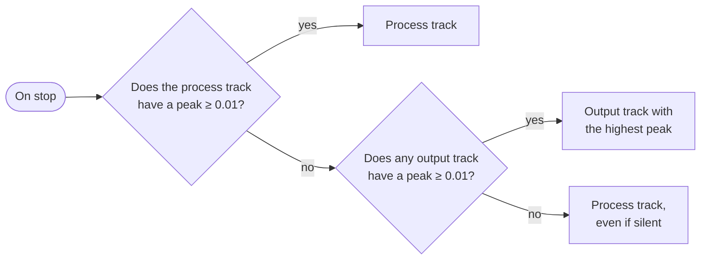

# Audio capture

`CaptureCoordinator` starts and stops three recorders, picks the main track when recording ends and writes the recovery file. Each recorder implements an interface (`IProcessCapture`, `IDeviceCapture`, `IMicCapture`), and the tests use doubles instead.

## The three recorders

| Recorder | API | WAV format | Temporary file |
|---|---|---|---|
| `ProcessLoopbackRecorder` | WASAPI *process loopback* (own COM interop in `Interop/`) | 16-bit PCM, 44.1 kHz, stereo (`AUTOCONVERTPCM`) | `recording_<date>.wav` |
| `DeviceLoopbackRecorder` | NAudio `WasapiLoopbackCapture` on the default output, *Console* and *Communications* roles (not duplicated when they are the same device) | The device's native format | `recording_<date>_console.wav`, `recording_<date>_communications.wav` |
| `MicrophoneRecorder` | NAudio `WasapiCapture` on the default input (*Multimedia* role) | The device's native format | `recording_<date>_mic.wav` |

They all write to `%TEMP%\LoopbackTranscriber\`, with `<date>` = `yyyyMMdd_HHmmss`.

### Process loopback

`Wasapi.ActivateProcessLoopbackAsync(pid, includeProcessTree)` activates a virtual `IAudioClient` with `AUDIOCLIENT_ACTIVATION_TYPE_PROCESS_LOOPBACK` and the `INCLUDE_TARGET_PROCESS_TREE` mode. This API exists from Windows 10 build 20348 onwards.

- The client is initialized in shared mode with `LOOPBACK | EVENTCALLBACK | AUTOCONVERTPCM | SRC_DEFAULT_QUALITY`.
- A dedicated thread (`LoopbackTranscriber-Capture`) waits for the sample event and writes each packet to the WAV.
- Besides being written to disk, each block is published on the `AudioCaptured` event, which feeds [live translation](live-translation.md). Only this recorder publishes it: **the live session only hears the application**.
- The WAV is opened with `FileShare.ReadWrite | FileShare.Delete` and a placeholder header. The real sizes are written when recording stops. If the application dies before then, the header stays at zero and [orphan recovery](reliability.md) repairs it.
- When stopping, it waits 5 s for the thread. If it does not finish, it stops the `IAudioClient` and waits another 5 s. If it still does not finish, it **abandons** the session: it fixes the header with what was written so far and returns the file. A hung driver never blocks the application.
- If the capture ended with an error but there is data, the audio is kept and a warning is logged. With no data, `ErrorAudioCapture` is thrown.

### Which process is recorded

`TargetProcessWatcher` checks the watched applications (`TargetApp.ProcessNames`) every 1.5 s. For each one:

1. `Process.GetProcessesByName` with each candidate name, for example `ms-teams` and then `Teams`.
2. `ProcessTree.FindRootProcessId` keeps the root process among those found.
3. `AudioSessionFinder.FindActiveProcessId` looks among the active audio sessions for one belonging to those processes. If there is one, that PID is used.

The **Applications** screen uses `AudioSessionFinder.ListRunningApps()` to list processes that have an audio session.

### Time gaps: `CaptureTimeline`

WASAPI delivers no packets when nothing is playing. Written as-is, the WAV would get shorter and the tracks would drift apart. `CaptureTimeline` compares each packet's timestamp (QPC) with the samples already written:

- If more than **250 ms** are missing, it fills the gap with silence (`WriteSilence`) before the packet.
- It keeps `FirstSampleTimestamp`, the instant of the first sample, which is used to align the microphone.
- Packets flagged `AUDCLNT_BUFFERFLAGS_TIMESTAMP_ERROR` are not used to measure gaps. NAudio devices, which provide no timestamp, use the arrival time minus the packet duration.

## Start (`StartAsync`)

1. Generates `baseName = recording_<date>` and marks it as **owned**, so orphan recovery does not touch it while recording.
2. Starts the process capture. If that fails, recording does not start and the error reaches the user.
3. Writes `recording_<date>.session.json` with the application and the time. If it cannot, it warns with `WarningRecoveryFileNotWritten`.
4. Starts the device capture. If that fails, it is logged and recording continues without it.
5. Starts the microphone. If that fails, it warns with `WarningMicNotRecorded`.
6. Rewrites the `.session.json` with the start time of each track.

## Stop (`StopAsync`)

Stops the three captures: the process first, then the device and the microphone, each on the thread pool. A failure in one does not prevent stopping the others. The microphone waits at most 3 s for `RecordingStopped`, and so does each device channel. Then:

### Choosing the main track

The threshold is `CaptureCoordinator.DeviceSignalThreshold = 0.01`, on a 0-to-1 scale. If the microphone track does not exceed that same threshold, `MicrophoneRecorder` deletes it when stopping.

### Microphone offset

The microphone track starts at a different instant from the main one. The offset (`MicStartOffset`) is computed:

1. from the first-sample timestamps of each track (`FirstSampleTimestamp`), if both exist;
2. otherwise, from the difference between the start times of each capture.

The result is a `StoppedRecording`: main track, microphone, offset, all paths, the stop error if any, the `baseName` and the warnings.

## After processing

- **On success**, `DeleteOriginals` deletes all the temporary WAVs and the `.session.json`, and releases the `baseName`.
- **On failure**, `PreserveFailed` moves the main track and the microphone to `FailedRecordingStore`. If even that is not possible, the originals stay in the temporary folder and recovery will find them on the next start.
- Every time `DeleteOriginals` runs, it also calls `DeleteStaleRecordings`, which deletes the `recording_*.16k.wav` files (derived files for Whisper) older than 7 days left in the temporary folder.
