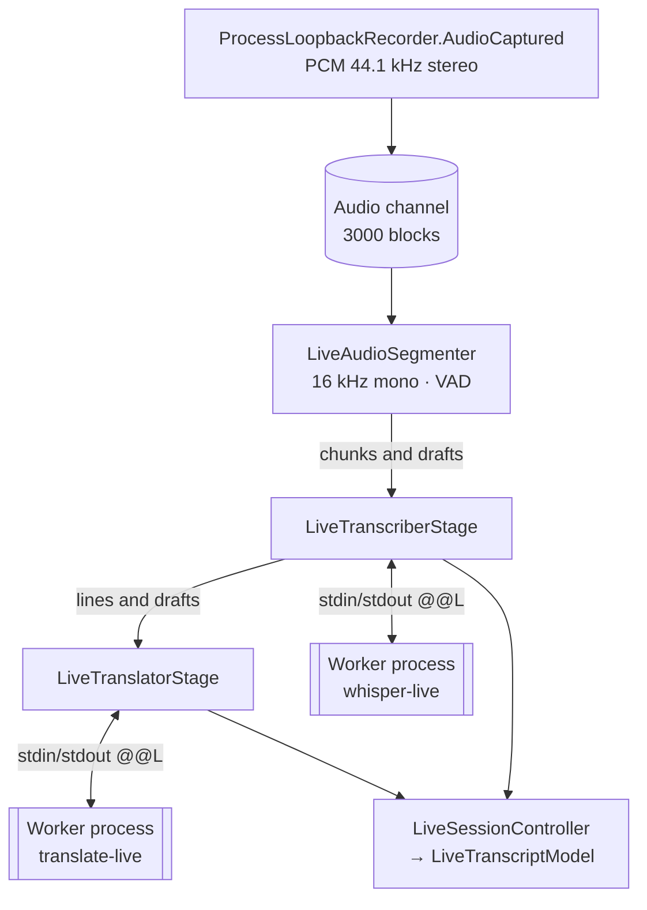

# Live translation

The live session (`LiveTranscriptionSession`) turns the application audio, while recording, into transcribed and translated lines. It is independent from the final transcription: it does not change the recording or its result.

## Pipeline

`LiveSessionController.Start` creates the session with:

- Whisper: the same model as the final transcription, the meeting language (`ResolveMeetingLanguage`), GPU, and `LiveAudioContext` and `LiveFlashAttention` from the settings.
- Translator: the summary model, if present, with `cores / 2` threads between 2 and 6. If it is not present, the session only transcribes.

Session events arrive from background threads. The controller marshals them to the UI thread and drops those from a session that is no longer the current one.

## 1. Segmentation (`LiveAudioSegmenter`)

It receives 16-bit PCM at 44.1 kHz stereo, mixes it down to mono and resamples to **16 kHz** by averaging. It works in **20 ms frames** (320 samples): a frame is speech if its level is above **−42 dBFS**.

| Rule | Value |
|---|---|
| Pre-roll when speech is detected | 10 frames (200 ms) |
| End of chunk on a pause | 30 frames (600 ms) of silence, or 15 frames (300 ms) if the chunk already lasts 3 s |
| Minimum speech to emit a chunk | 20 frames (400 ms) |
| Trailing silence kept | up to 10 frames (200 ms) |
| Maximum length | 500 frames (10 s). It is cut at the quietest frame within the last 3 s. |
| Draft | when the chunk has at least 25 speech frames and either 40 frames (800 ms) have passed since the last draft without reaching 10 silent frames in a row, or it has just reached 8 silent frames with more than 3 new speech frames since the last draft |

A **draft** is the chunk in progress, still open, that is transcribed to show provisional text. Each draft carries a sequence number (`DraftSeq`). If the final chunk exactly covers the last draft (with a 3-speech-frame tolerance), it says so, so that its text can be reused.

## 2. Transcription (`LiveTranscriberStage`)

It uses a `LiveWorkMailbox`: a bounded queue of **8 final chunks** that drops the oldest when full, plus **a single draft slot** where the latest draft replaces the previous one.

- **Priority.** Final chunks go before drafts. The exception is when the pending draft is exactly the one preceding that final chunk.
- **Generations.** Each final chunk advances a counter (`LiveGeneration`). A draft transcribed after a newer final chunk has arrived is discarded, so old text is never shown over newer text.
- **Reuse.** If a final chunk covers the last transcribed draft, its text is used without calling Whisper again. The metrics mark it as `chunk-reused`.
- A final line identical to the previous one, ignoring case, is not repeated.
- `LiveTextSplitter` splits each final line: if it is **90 characters or longer**, it is cut at sentence ends (`.`, `!`, `?`, `…`) into pieces of at least 28 characters.

The `whisper-live` worker keeps the model loaded for the whole session. Each request carries the 16 kHz PCM in base64. The worker pads it with silence up to 1 s if shorter and applies the same segment filters as the final transcription, with a no-speech threshold of 0.6.

## 3. Translation (`LiveTranslatorStage`)

It uses another queue, of **6 lines**, with a draft slot. A line dropped because the queue is full is marked as **not translated** (`TranslationSkipped`) instead of waiting forever.

- Each line is translated with the **previous line as context**, which is not translated itself.
- Drafts are translated too, to show a provisional translation. If the final line was not split and matches the last translated draft, that translation is reused (`translation-reused` in the metrics).
- Changing the target language applies to whatever is queued from then on.

The `translate-live` worker loads Qwen3-4B with a 2048-token context, temperature 0.2, top-k 20 and top-p 0.9, and a token limit that depends on the text length (between 64 and 400). The prompt asks it to act as an interpreter that returns only the translation. It includes `/no_think` and an empty, pre-filled `<think>` block so Qwen3 does not reason before answering. Before announcing itself as ready, it translates a test sentence to warm the model up.

## 4. Worker supervision (`LiveWorkerSupervisor`)

| Situation | Reaction |
|---|---|
| The worker answers a request with `Error` | It is logged and that chunk or line is skipped. |
| A timeout (60 s for Whisper, 30 s for translation) or the process dies | The worker is restarted, at most **3 times** per session. |
| The worker is not ready within 180 s | The session reports the error. |
| Further failures | The window shows the error. The recording carries on unchanged. |

## Metrics

Each chunk and each translation is written to `%LocalAppData%\LoopbackTranscriber\live-metrics.log`.

Each line starts with the date and time:

| Line | Fields |
|---|---|
| `chunk` (or `chunk-reused` when it reuses the draft, `draft` for a draft) | `audio` seconds of audio · `whisper` processing seconds · `rtf` processing over audio · `latency` delay since speech ended · `queue` queued chunks · `dropped` dropped · `chars` characters |
| `translation` (or `draft-translation`) | `chars` characters · `model` translation seconds · `latency` delay · `queue` queued lines |
| `translation-reused` | `chars` characters |

When the session closes, a `SUMMARY` line is added with the model, whether the GPU was used, the audio context, flash attention, the dropped and reused chunks, and the 50th and 90th latency percentiles for chunks, drafts and translations. The window shows the same data in its technical strip (`LiveMetricsPresenter`).

## Dropped audio

The input channel holds at most 3000 blocks and drops the oldest. This only happens if the segmenter stalls, which should not happen because it only does in-memory computation. The first drop is logged once in `app.log`.
