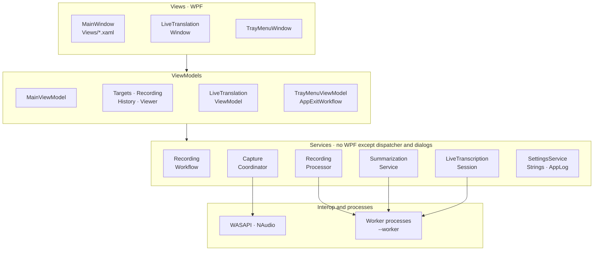

# Overview

LoopbackTranscriber is a single WPF project (`LoopbackTranscriber.csproj`, `net10.0-windows`) plus a test project (`LoopbackTranscriber.Tests`). It follows MVVM with CommunityToolkit.Mvvm and a Microsoft.Extensions.DependencyInjection container.

## Layers

| Folder | Contents |
|---|---|
| `Views/`, `MainWindow*.cs`, `Converters/`, `Styles/` | XAML and code-behind. Presentation only: window, tray, calendar, floating window. |
| `ViewModels/` | State and commands of each screen. They do not know the views. |
| `Services/` | Logic: capture, processing, transcription, summary, live session, persistence, localization and logging. |
| `Models/` | Plain data: settings, watched applications, history items, speaker labels. |
| `Interop/` | WASAPI COM interfaces, *process loopback* activation, audio sessions and the process tree. |
| `Build/` | `LocalizationCheck.targets`: build-time translation check. |
| Root | `Program`, `App`, `AppServices` (container), `CrashHandler`, `SingleInstance`. |

## Design principles

**Nothing leaves the computer.** The only network access is downloading the two models, from fixed Hugging Face revisions and with their SHA256 checked. See [Models and integrity](models.md).

**No audio is lost.** A recording that cannot be transcribed is kept to be retried, also when the application closes, hangs or the computer shuts down. See [Reliability](reliability.md).

**Inference runs in separate processes.** Whisper and LLamaSharp allocate native and GPU memory that is not always released when the model is unloaded. Each transcription and each summary runs in a child process that exits when done. That keeps the main application light while it waits in the tray. See [Worker processes](workers.md).

**Services do not depend on WPF.** `RecordingWorkflow`, `RecordingProcessor`, `CaptureCoordinator` and the parts of the live session (segmenter, work queue, line splitting) are tested without a window. Dependencies on the system (capture, Whisper, audio conversion, dialogs, dispatcher, process watcher) sit behind interfaces that the tests replace with test doubles.

**Child ViewModels do not know each other.** The shell (`MainViewModel`) coordinates them, and they talk to each other through messages. See [ViewModels and messaging](viewmodels.md).

## Main dependencies

| Package | Version | Used for |
|---|---|---|
| CommunityToolkit.Mvvm | 8.4.2 | `ObservableObject`, `[ObservableProperty]`, `[RelayCommand]`, `WeakReferenceMessenger`. |
| Microsoft.Extensions.DependencyInjection | 10.0.0 | Service container. |
| WPF-UI | 4.3.0 | Dark theme, accent color and Fluent controls. |
| NAudio | 2.2.1 | Device and microphone capture; reading, writing and converting WAV. |
| Whisper.net (+ Runtime, Runtime.Vulkan) | 1.9.1 | Speech recognition, on the CPU or on a Vulkan GPU. |
| LLamaSharp (+ Backend.Cpu, Backend.Vulkan) | 0.27.0 | Summaries and translation with Qwen3-4B. |

## Runtime settings

The `.csproj` turns off concurrent GC and *Tiered PGO*, and sets `System.GC.ConserveMemory=5`. All of this aims to reduce the resident memory of an application that spends most of its time in the tray. In addition:

- `MemoryTrimmer.Release()` compacts the heap and trims the working set: after each transcription and each summary, when a recording finishes processing, when the window is minimized or hidden, and once 4 s after it is first shown.
- `BackgroundMemoryTrimmer` trims the working set every 5 minutes while the window is minimized or hidden in the tray.
