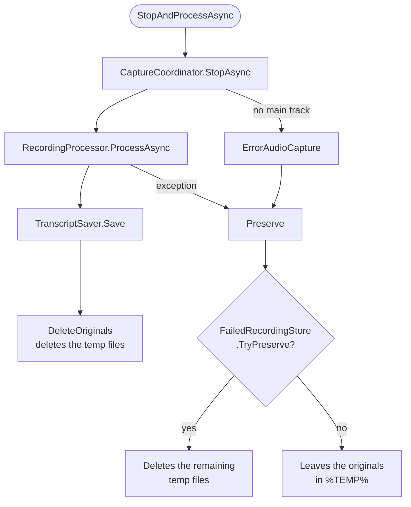

# Processing a recording

## The flow: `RecordingWorkflow`

`RecordingWorkflow` does not depend on WPF. It chains capture, processing and saving, and decides what to do with the audio if something fails. `RecordingViewModel` only maps the result (`RecordingResult`) onto properties.

| Method | Used for |
|---|---|
| `StartAsync(pid, appName)` | Starts the capture. Returns the start-up warnings, such as the microphone not being recorded. |
| `StopAndProcessAsync(appName, recordedAt, callbacks)` | Normal stop: processes, saves and cleans up. On failure, keeps the audio. |
| `StopAndPreserveAsync(appName, recordedAt, reason)` | Stops and keeps the audio **unprocessed**. Used on exit, on shutdown and on errors. |
| `RetryAsync(failedRecording, callbacks)` | Processes a preserved recording. On success, removes it from the store. |
| `ListFailed()` / `DiscardFailed(recording)` | Unprocessed recordings. |
| `RecoverOrphans()` | Recovery at startup. See [Reliability](reliability.md). |

The summary is **not** part of this flow: it is generated manually from the viewer.

## Processing: `RecordingProcessor`

`ProcessAsync(sourceWav, micWav, micStartOffset, settings, callbacks)` takes the tracks and returns the final text. It uses `IWhisperTranscriber` and `IAudioPreparer`, which the tests replace.

1. **Model.** `EnsureModelDownloadedAsync` checks the model and downloads it if missing. Status: "*Checking the transcription model...*".
2. **Conversion.** Both tracks are converted to 16-bit PCM WAV, **16 kHz, mono** (`AudioConverter.ConvertToWhisperFormat`: 50% mono mixdown and WDL resampling) into `<name>.16k.wav`.
3. **Noise gate on the microphone.** `ApplyNoiseGate` silences the 50 ms windows whose RMS level is **more than 34 dB below the track's peak**, with 10 ms fades at each change. If it fails, the track is transcribed unfiltered.
4. **Transcription** of both tracks (see below). Combined progress is the average of the two.
5. **Microphone activity.** Microphone segments with less than 15% active windows, or less than 0.15 s active, are dropped (`GetActivityMap`, 50 ms windows).
6. **Echo filter** between the microphone and the application (see below).
7. **Composition** of the text with speaker labels.
8. If the text is empty and the audio is **20 s or longer**, `ErrorNoTextInAudio` is thrown: the recording is kept as failed. If it is shorter, the empty text is returned: `TranscriptSaver` saves nothing and `RecordingWorkflow` deletes the temporary files as for any finished recording.
9. The `.16k.wav` files are always deleted at the end, in a `finally`.

### Language

| `MeetingLanguage` | Application track | Microphone | Execution |
|---|---|---|---|
| `""` (default) | application language | same | In parallel, each with half the threads. |
| `es`, `en`, `pt`, `de`, `ru` | that one | that one | In parallel. |
| `auto` | detected | **the one detected on the application track** | In sequence: first the application, then the microphone with that language. |

Detection (`LanguageDetector`) measures the level of each second of the track and tries 30 s windows starting every 5 s. It keeps the 3 with the most active seconds, at least 8 and without overlapping. On each it calls Whisper's `DetectLanguageWithProbability` and adds up the probability of the language returned. The confidence is the winning language's total divided by the number of windows. If it does not reach **0.5**, the application language is used. The result is written to `app.log`.

### Whisper (`WhisperTranscriptionService`)

- A **silent** track (peak ≤ −50 dBFS) returns 0 segments without starting any process.
- Each transcription runs in a `whisper` **worker process**. See [Worker processes](workers.md).
- Threads per instance: `cores / 2 / concurrent transcriptions`, between 2 and 16.
- Parameters: no context between segments (`WithNoContext`), no-speech threshold **0.6** (0.45 for the microphone, strict mode) and probabilities enabled. Vulkan GPU when available.

Per-segment filters (`FilterSegmentText`), in order:

1. Drops non-speech tags such as `[MUSIC]` or `(applause)` and text with no letters or digits.
2. Drops segments with a no-speech probability ≥ 0.6 (≥ 0.45 in strict mode).
3. Drops typical hallucination phrases ("thank you", "gracias por ver el video", "subtitles by the amara.org community"…) if their no-speech probability is ≥ 0.3 (≥ 0.2 in strict mode).
4. Drops text written in a different alphabet from the language's: 30% or more of the letters outside it. Only applies to Latin- and Cyrillic-script languages. It does not apply when the language is undetermined.
5. Removes phrases repeated in a loop (`RemovePhraseLoops`) and drops repetitions of a single word (`IsRepeatedWordLoop`).

On the whole set: `RemoveRepeatedSegments` removes repeated segments and `MergeCloseSegments` joins those separated by **2 s or less**, up to 400 characters.

### Echo filter (`MeetingEchoFilter`)

With speakers, the microphone also picks up the participants, and with headphones the application sometimes plays back your own voice. For each microphone segment of **3 words or more**:

1. Finds the overlapping application segments, with a ±3 s margin, once the microphone offset is applied.
2. If they share at least **60%** of their words, they are the same sentence. If not, the segment is left as it is.
3. Decides **who spoke first**. The microphone is the original if it starts **300 ms or more earlier**, or if it starts within 150 ms and is **loud**. Loud means its 75th-percentile level is within 10 dB of the 90th percentile of the whole track (`MicLoudness`).
4. If the microphone is the original, it is kept, and the application segments that are 60% or more contained in it are removed. Otherwise, the microphone segment is dropped as echo.

### Composition (`TranscriptComposer`)

- Sorts all segments by start time. Microphone segments are shifted by `MicStartOffset`.
- Starts a new paragraph when the speaker changes, after a pause of **3 s or more**, or when the paragraph exceeds **700 characters**.
- If there is any microphone segment, each paragraph starts with a label: `Participantes:`, `Tu:` or `<name> (Tú):`. Otherwise the text has no labels.

Labels are **always stored in Spanish** (`SpeakerLabels`) so the file does not depend on the interface language. The viewer translates them when displaying them (`SpeakerDisplay`).

## Saving: `TranscriptSaver`

It writes to `<TranscriptsFolder>\<App>\<App>_<yyyyMMdd_HHmmss>\`:

| File | Contents |
|---|---|
| `<base>.md` | The header `# <App> - dd/MM/yyyy HH:mm`, a blank line and the text. |
| `<base>.wav` | Copy of the main track. |
| `<base>_mic.wav` | Copy of the microphone, if there is one. |
| `<base>.recording.json` | `MicStartOffsetTicks`, only if there is a microphone. |

`<App>` is the application name with characters that are invalid in a file name replaced by `_` (`TranscriptHistoryService.GetAppFolderName`). If the text is empty, nothing is saved.

## Re-transcription (`TranscriptRetranscriber`)

1. Takes `<base>.wav`, `<base>_mic.wav` if it exists, and the offset from `<base>.recording.json`, or 0 if there is none.
2. Runs `RecordingProcessor.ProcessAsync` with the current settings, in a work folder `%TEMP%\LoopbackTranscriber\retranscribe\<guid>` that is deleted at the end.
3. Rewrites the `.md`, keeping its header. Old transcripts in `.txt` are rewritten as `.txt`.
4. Unlike a new recording, an empty result is always an error, whatever the duration.
