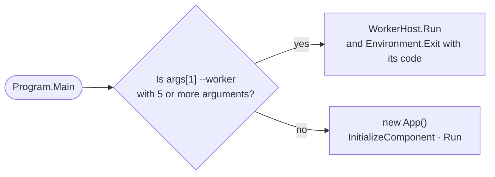

# Startup and shutdown

## Entry point

`Program.Main` (`[STAThread]`) first decides whether the process is the application or a **worker process**:

A worker process **never creates `App` or any window**.

`App.xaml` is declared as a `Page` and not as an `ApplicationDefinition` (the `.csproj` does this) so that this is the `Main` used, not the one WPF generates. That way a worker process starts without loading anything from the UI. See [Worker processes](workers.md).

## `App.OnStartup`

In this order:

1. **`CrashHandler.Install`** subscribes to `DispatcherUnhandledException`, `AppDomain.UnhandledException` and `TaskScheduler.UnobservedTaskException`. It comes first so it also covers startup itself.
2. **`SingleInstance.TryAcquire`** takes the `Local\LoopbackTranscriber-B6E1F6C4-…` mutex. If another instance already holds it, it signals that instance's `…-Activate` event (with `AllowSetForegroundWindow` so it can come to the front) and this one exits. A mutex abandoned by an instance that crashed is taken over anyway.
3. **Settings**: creates `UserNotices` and `SettingsService`. `EnsureDefaultUserName()` suggests the Windows name the first time, and the language is set with `Strings.Instance.SetLanguage(...)`.
4. **Theme**: WPF-UI dark, with the `#6A2BD9` accent.
5. **Container**: `AppServices.Build(settings, notices)` registers every service and ViewModel and validates the graph when building it (`ValidateOnBuild = true`).
6. Resolves `MainWindow`, registers it with `CrashHandler.Attach` together with `RecordingViewModel` so the recording can be rescued, starts listening for activations from other instances and shows the window.

The `MainWindow` constructor calls `MainViewModel.Start()`, which:

- starts the process watcher (`TargetsViewModel.Start`);
- loads the history;
- starts, in the background, the **recovery of orphan recordings** and the **verification of the installed models**.

## The container (`AppServices`)

Everything is a singleton except the ViewModels of the secondary pages, which are transient and created on demand through `IPageFactory`:

| Registration | Implementation |
|---|---|
| `ISettingsStore` | `SettingsService` (created before the container) |
| `UserNotices` | shared instance of user notices |
| `ITargetWatcher` | `TargetProcessWatcher` |
| `ICustomAppsService` | `CustomAppsService` |
| `ISummarizer` | `SummarizationService` |
| `IModelVerifier` | `ModelVerifier` |
| `IWhisperTranscriber` | `WhisperTranscriptionService`, which is also registered as its own type |
| `IAudioPreparer` | `NaudioAudioPreparer` |
| `TranscriptHistoryService`, `TranscriptsFolderWatcher` | — |
| `RecordingProcessor`, `TranscriptSaver`, `TranscriptRetranscriber` | — |
| `FailedRecordingStore` | folder `%LocalAppData%\LoopbackTranscriber\failed` |
| `CaptureCoordinator` | with `ProcessLoopbackRecorder`, `DeviceLoopbackRecorder`, `MicrophoneRecorder` and the `FailedRecordingStore` |
| `RecordingWorkflow` | — |
| `IDialogService` | `WpfDialogService` |
| `IUiDispatcher` | `WpfUiDispatcher.Instance` |
| `IMessenger` | `WeakReferenceMessenger.Default` |
| Shell ViewModels | `HistoryViewModel`, `ViewerViewModel`, `TargetsViewModel`, `RecordingViewModel`, `MainViewModel` |
| `IRecordingHost` | `RecordingHost` |
| `ILiveTranslationFactory` | `LiveTranslationFactory` |
| Others | `TrayMenuViewModel`, `AppExitWorkflow`, `UserNoticePresenter`, `MainWindow` |
| Transient | `FirstRunViewModel`, `ConfigViewModel`, `ApplicationsViewModel`, `LiveTranslationSettingsViewModel` |
| `IPageFactory` | `ServiceProviderPageFactory`, which resolves them from the container |

## First run or application

The `MainViewModel` constructor checks whether both models exist, `models\whisper\ggml-turbo.bin` and `models\llm\Qwen3-4B-Q4_K_M.gguf`:

- If they do, it sets `FirstRunSetupCompleted`, selects the first application and shows `AppView`.
- If not, it creates `FirstRunViewModel` and shows `FirstRun`. When that completes, it opens `Config`.

If the startup verification deletes a damaged model, the app goes back to `FirstRun`, unless a recording is in progress or being processed.

## Shutdown

There are four ways for the application to end. None of them deletes unprocessed audio.

| Situation | What happens |
|---|---|
| **Window X** | `Closing` is cancelled and the window is hidden to the tray (`HideToTray`). |
| **Exit** from the tray | `AppExitWorkflow.ConfirmExitAsync` decides (see below). If a summary is being generated, you are asked to confirm because it would be lost. |
| **Windows sign-out or shutdown** | `SessionEnding` lets the app close and calls `RecordingViewModel.PreserveInterruptedRecording(3 s)`: it stops the capture and keeps the audio unprocessed. |
| **Unhandled error** | `CrashHandler` preserves the recording (3 s), shows the message with the log path and exits with code 1. |

### `AppExitWorkflow`

1. Waits, for 10 s at most, for a half-started recording to finish starting.
2. **With a recording in progress**, asks Yes / No / Cancel:
   - *Yes*: shows the window, stops and processes (`IRecordingHost.StopRecordingAsync`) and exits.
   - *No*: keeps the audio unprocessed (`PreserveInterruptedRecordingAsync`, 10 s at most) and exits.
   - *Cancel*: does not exit.
3. **With a recording being processed**, asks whether to wait. If accepted, it shows the window and waits until `IsBusy` becomes `false`.
4. While an exit is pending, further exit requests are ignored.

### `App.OnExit`

Disposes the container, which disposes recorders, watchers and timers. Then it writes any settings that could not be saved (`FlushPendingWrite`) and releases the single-instance mutex.

## `CrashHandler`

| Event | Handling |
|---|---|
| `DispatcherUnhandledException` (UI thread) | Marks it handled, logs it, rescues the recording, shows `CrashBody`, `CrashBodyPreserved` or `CrashBodyLost` and closes the application. |
| `AppDomain.UnhandledException` (other thread) | Logs it, rescues the recording on the UI thread (giving it 2 s to respond) and shows the same message. The process ends anyway. |
| `UnobservedTaskException` | Only logs it and marks it observed. |

A second error while the first one is being handled is only logged.
