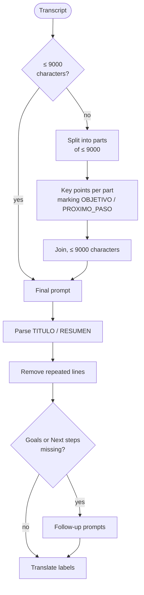

# Summary

`SummarizationService` implements `ISummarizer`. `ViewerViewModel` calls it with the transcript text, the model path and the interface language. The result (`RecordingSummary`: `Title` and `Summary`) is saved to `<base>.summary.json`.

## Where it runs

`SummarizeAsync` serializes a `SummaryJob` (`TranscriptText`, `ModelPath`, `UiLanguage`) and runs it in a `summary` worker process. Progress arrives as `@@P <percentage>`. Inside the worker, `SummarizeInProcessAsync` does the actual work. When the process ends, all the model's memory is released. See [Worker processes](workers.md).

## Model and parameters

| Parameter | Value |
|---|---|
| Model | `Qwen3-4B-Q4_K_M.gguf` (see [Models and integrity](models.md)) |
| Context | 8192 tokens |
| GPU layers | all (`GpuLayerCount = 999`), with the Vulkan backend if available; otherwise CPU |
| Threads | `cores / 2`, between 2 and 6 |
| Executor | LLamaSharp `StatelessExecutor`: each prompt is independent |
| Normal sampling | temperature 0.6, top-k 30, top-p 0.9, repeat penalty 1.12, frequency 0.3, presence 0.3, penalty window 512 |
| Strong sampling | temperature 0.8, repeat penalty 1.25, frequency 0.6, presence 0.5 |
| Stop | `<\|im_end\|>` or `</s>` |

## Steps

### 1. Condense if long

If the transcript exceeds 9000 characters, `SplitIntoChunks` splits it into pieces of at most 9000. Each piece gets the `Chunk` prompt (at most 600 tokens), which asks for a list of key points:

- Goals and commitments are marked `[OBJETIVO]`, and upcoming meetings or follow-ups `[PROXIMO_PASO]`.
- Each part is trimmed to its character quota (`FitPointsToLimit`). Marked points are always kept, even when the others do not fit.
- The parts are joined under `Puntos clave (parte i de N):`. The whole is trimmed to 9000 characters.

### 2. Final prompt

The `Final` prompt (at most 1800 tokens) asks for **plain text** in exactly this format:

| Label | Contents |
|---|---|
| `TITULO:` | The title, on the same line. |
| `RESUMEN:` | Marks the start of the sections. |
| `Proposito:` | Two or three sentences. |
| `Puntos clave:` | One line per point, starting with `- `. |
| `Temas:` | Each topic on a `* Topic` line and, below it, its details with `- `. |
| `Objetivos:` | One line per goal, with `- `. |
| `Proximos pasos:` | One line per step, with `- `. |

The prompt's rules: write in the requested language even if the transcript is in another one, between 5 and 12 key points, invent nothing, leave out empty sections and do not repeat yourself. It also explains the speaker labels (`Tu`, `<name> (Tú)`, `Participantes`) so the model only uses them when they add something. The placeholders `{{SELF}}`, `{{SELF_NAMED}}` and `{{OTHERS}}` are replaced with `SpeakerLabels.ApplyToPrompt`.

The prompts are written in Spanish, and the labels the model must produce are always the Spanish ones. Step 6 translates them.

### 3. Repetition loops

While generating, `GenerateAsync` compares each new line of 5 words or more with the previous 10 lines. Two lines are near-duplicates if their Jaccard index over words of 3 or more letters is **≥ 0.72**. If 3 near-duplicates appear, it stops and **runs the generation again with the strong sampling**.

### 4. Parsing the answer (`ParseResult`)

1. Removes Qwen3's `<think>…</think>` block if there is one (`StripThinkBlock`).
2. Looks for the plain `TITULO:` / `RESUMEN:` format. It accepts accents, asterisks and any letter case.
3. If not found, looks for the first JSON object with `title` and `summary`.
4. Failing that, uses the first line as the title (60 characters at most) and the whole text as the summary.

Then `RemoveRepeatedLines` removes near-duplicate lines within each section.

### 5. Missing sections

If the summary has no **Objetivos** (goals) or **Próximos pasos** (next steps), it asks for them with the `Goals` and `NextSteps` prompts (at most 300 tokens each) over the same text. The model answers `NINGUNO` if there are none. At most 8 items are added, normalized as `- …`.

### 6. Labels in the interface language

The model always writes the labels in Spanish: `Proposito`, `Puntos clave`, and so on. `LocalizeSectionLabels` replaces them with the `SummaryLabel*` keys of the requested language, except in Spanish, where they are left as they are. It also recognizes variants the model sometimes writes: with or without accents, singular ("Objetivo", "Próximo paso"), "Siguientes pasos" and "Tareas", which has its own label (`SummaryLabelTasks`) even though the prompt does not ask for it.

## How it is displayed

`ViewerViewModel` runs the saved text through `SummaryFormatter.Parse`, which splits it into sections (`SummarySection`) for the viewer:

- It recognizes section labels in the five languages ("Puntos clave", "Key points", "Kernpunkte"…) and shows each title with the text of the **current** language and its icon. A summary generated in Spanish shows English titles if the interface is switched to English; the content does not change.
- `- …` lines are bullets, `* …` lines are topics, and bullets under a topic are indented one level.

## Progress

`ProgressTracker` splits 100% between loading the model (150 units), each part (100 for prefill plus about 450 expected tokens) and the final prompt (100 plus about 900 tokens). The percentage stays at 99 until the end.

## Usage restrictions

- No summary is generated while recording or while a recording is being processed (`CaptureStateChangedMessage`).
- Recording cannot start while a summary is being generated (`SummaryActivityChangedMessage`).
- Closing the window during a summary asks for confirmation.
