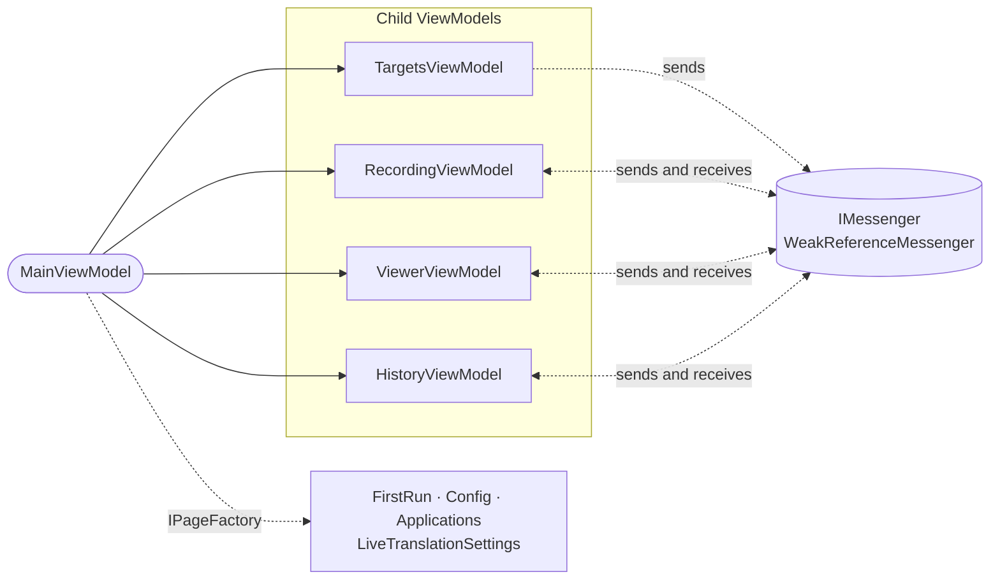

# ViewModels and messaging

## The shell and its children

`MainViewModel` is only the **shell**: navigation between screens, application selection, and the entry points for the tray and the floating window. It receives four child ViewModels, an `IPageFactory`, `ISettingsStore`, `IMessenger` and `IModelVerifier`. It does not depend on any concrete service.

| Child | Responsibility | Depends on |
|---|---|---|
| `TargetsViewModel` | Watched applications, their state (open or not, PID), selection and added applications. | `ITargetWatcher`, `ICustomAppsService` |
| `RecordingViewModel` | Recording and stopping, status and timer, unprocessed recordings of the selected application (retry or discard), orphan recovery and rescue on shutdown. | `RecordingWorkflow`, `IDialogService` |
| `HistoryViewModel` | Global and per-application history, each with its own search (`HistorySearchState`) and filters (`HistoryFilterState`), selection and deletion. Watches the folder with `TranscriptsFolderWatcher`, which batches changes over 500 ms. | `TranscriptHistoryService` |
| `ViewerViewModel` | Viewer (Transcript and Summary tabs), generating and regenerating summaries, and re-transcription. | `ISummarizer`, `TranscriptHistoryService`, `TranscriptRetranscriber` |

**Rule**: the shell calls the children directly. The children **do not reference each other**: they only talk through messages.

## Messages

They are all defined in `ViewModels/Messages.cs` and travel through `WeakReferenceMessenger`. Subscriptions use static lambdas that take the recipient as a parameter, so they do not capture `this`, and each ViewModel unsubscribes in `Dispose` with `UnregisterAll`.

| Message | Sender | Receivers | Meaning |
|---|---|---|---|
| `TargetSelectionChangedMessage(Target)` | Targets | Shell, Recording | The selected application changed. The shell navigates to its view and Recording takes it as the target. |
| `TargetStatusesSyncedMessage` | Targets | Shell | The application states were refreshed. The shell forwards it to Recording, which stops recording if the recorded application closed. |
| `TargetListChangedMessage` | Targets | Shell | An application was added or removed. |
| `CaptureStateChangedMessage(IsActive)` | Recording | Viewer | A capture or processing is in progress. Blocks summaries and re-transcriptions. |
| `TranscriptReadyMessage(Text, FilePath)` | Recording | Viewer | There is a new transcript to show. |
| `RecordingSavedMessage` | Recording, Viewer | History | Something changed on disk. History reloads. |
| `TranscriptDeletedMessage(FilePath)` | History | Viewer | A transcript was deleted. If it was open, the viewer is cleared. |
| `SummaryActivityChangedMessage(IsGenerating)` | Viewer | Recording | A summary is being generated. Blocks starting a recording. |
| `FindTranscriptRequest(FilePath)` | Viewer | History | Request with a reply: Viewer asks for the `TranscriptHistoryItem` of a path. |
| `LiveTranslationPreferencesChangedMessage` | Floating window, live settings | Floating window, live settings | A live translation preference changed. Both resynchronize. |
| `TranslucentUiChangedMessage(Enabled)` | Config | `MainWindow` | Turn the translucent interface on or off. |

## Secondary pages

`IPageFactory` creates `FirstRunViewModel`, `ConfigViewModel`, `ApplicationsViewModel` and `LiveTranslationSettingsViewModel` on demand. They are transient in the container. The shell keeps the instance it created and calls `RefreshFromDisk()` when you come back to the page. When leaving `Config`, it calls `FlushPendingChanges()` to save a user name that is still being typed.

Navigation is a `CurrentView` property of type `MainViewMode` (`FirstRun`, `AppView`, `History`, `Config`, `Applications`, `LiveTranslation`), plus one `Is…Active` boolean property per screen for the bindings.

## `IRecordingHost`: the recording seen from outside

The floating window and the tray menu need to know whether recording is in progress, start or stop it, and receive the audio. But they must not know the shell. `IRecordingHost` exposes exactly that:

| Member | Used for |
|---|---|
| `IsRecording`, `IsBusy`, `StatusText`, `ElapsedText`, `IsTranscribingActive`, `TranscriptionProgressPercent` | State that is displayed. |
| `CanToggleRecording`, `RecordDisabledReason`, `CanStartRecordingFor(target)` | Whether recording is possible and, if not, why. |
| `SelectedTarget` | Selected application. |
| `StartRecordingForAsync(target)` | Selects the application with `Targets.Select` and only records if the selection really took effect in both Targets and Recording. |
| `StopRecordingAsync()` | Stops and processes. |
| `AudioCaptured` | PCM blocks from the application track, for the live session. |

`RecordingHost` implements it directly on top of `RecordingViewModel` and `TargetsViewModel`, and forwards their `PropertyChanged`.

## The floating window

`LiveTranslationViewModel` only holds the window state. `LiveTranslationFactory` creates it for a specific application (`Create(target, openMainWindow)`), and it relies on three pieces:

| Piece | Responsibility |
|---|---|
| `LiveSessionController` | Life cycle of the `LiveTranscriptionSession`: start it with the current models and settings, feed it audio, stop it, and marshal the session events to the UI thread. It drops events from a session that is no longer the current one. |
| `LiveTranscriptModel` | The lines shown (`LiveLine`), the transcription and translation drafts and their rules: what gets replaced, what is marked as not translated, when it is cleared. |
| `LiveMetricsPresenter` | The texts of the technical data strip. |

The live session starts when the window is open **and** its application is being recorded, no matter who started the recording. It stops when recording of that application stops. How the session works is in [Live translation](live-translation.md).

## The tray

- `TrayMenuViewModel.Build(actions)` builds the menu entries (`TrayMenuEntry`) according to the state:
  - during the first run, only *Open* and *Exit*;
  - when not recording, *Start recording X* for each watched application, enabled only if it can be recorded, and, if recording is blocked, the reason as a disabled entry;
  - while recording, a status line with the live elapsed time and *Stop recording X*, which also shows the window;
  - always, *Live translation for X* for each watched application, enabled only if it is open, or, if a floating window is open, only *Close live translation for X*.
- Record and stop actions run through a single `AsyncRelayCommand`. While one is running, the entries are disabled and extra clicks are ignored.
- `TryRunExit` prevents starting two exits at once.
- `TryConsumeTrayHint` shows the "still running in the tray" notification only once and saves that in the settings.
- `TrayIconService` manages the native icon and `TrayMenuWindow` draws the menu.

## User notices

Services that must not show dialogs (settings, history, failed recordings store, model verifier) add notices to `UserNotices`. `AddOnce(identity, …)` avoids repeating the same notice. `UserNoticePresenter` starts showing them once the window has rendered for the first time. From then on it shows them as soon as they arrive, all pending ones together in a single "Notice" dialog.

## Threads

ViewModels are updated on the UI thread. Events coming from other threads (process watcher, live session, worker process progress) go through `IUiDispatcher` or through a `Progress<T>` created on the UI thread.
