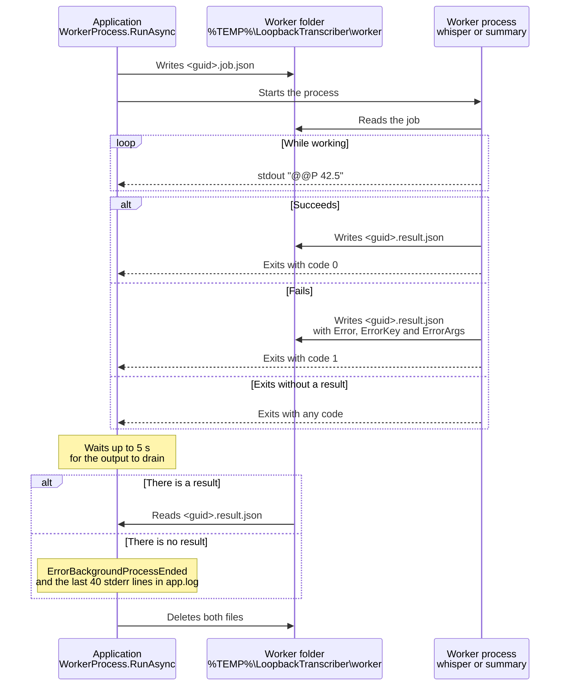

# Worker processes

Whisper.net and LLamaSharp allocate native and GPU memory that is not always returned to the system when the model is released. To keep the main application from growing with each use, **all inference runs in child processes**: the same executable started in *worker* mode.

## Command line

`LoopbackTranscriber.exe --worker <type> <job-path> <result-path> <parent-pid>`

| Argument | Meaning |
|---|---|
| `--worker` | Marks the process as a worker. |
| `<type>` | `whisper`, `summary`, `whisper-live` or `translate-live`. |
| `<job-path>` | The JSON file with the job. |
| `<result-path>` | Where the process writes the result. |
| `<parent-pid>` | The application's PID, for the parent watchdog. |

`WorkerProcess.CreateStartInfo` builds it from `Environment.ProcessPath`. If the application runs as `dotnet LoopbackTranscriber.dll`, for example from the debugger, it adds the assembly path as the first argument. The process is created without a window and with standard output and standard error redirected.

`Program.Main` recognizes the invocation with `WorkerHost.IsWorkerInvocation`: the second argument must be `--worker` and there must be at least 5. In that case it runs `WorkerHost.Run` and exits **without creating `App`**.

| Type | Mode | Job | Result |
|---|---|---|---|
| `whisper` | batch | `WhisperJob` | `WhisperJobResult` |
| `summary` | batch | `SummaryJob` | `SummaryJobResult` |
| `whisper-live` | persistent | `LiveWhisperConfig` | over stdout |
| `translate-live` | persistent | `LiveTranslatorConfig` | over stdout |

Job files are written to `%TEMP%\LoopbackTranscriber\worker\` with a GUID as the name: `<guid>.job.json` and `<guid>.result.json`, or `<guid>.live.json` for the persistent ones. They are deleted at the end.

## Parent watchdog

When `<parent-pid>` is passed, the worker starts a background thread that waits for that process to end. When it ends, or if it no longer exists, the worker exits with **code 2**. That way no worker outlives the application, even if it dies abruptly.

## Batch mode (`whisper`, `summary`)

- **Progress**: `@@P <number>` lines on standard output, in invariant culture with up to 3 decimals (`WorkerProtocol.FormatProgress` / `TryParseProgress`). Any other line is ignored.
- **Result**: the worker writes the JSON and exits with 0.
- **Error**: on failure, it writes to the result file an object with `Error` (the message) and, if the exception carried a localization key, `ErrorKey` and `ErrorArgs`, and exits with 1. The application turns that into an exception with the same key (`UserError.FromWorker`), so the user sees the message in their own language.
- **No result**: if the process ends without writing anything (because a driver hangs, or the C++ runtime is missing), `ErrorBackgroundProcessEnded` is thrown with the exit code. The last 40 lines of stderr are written to `app.log` (`WorkerStderrTail`).
- **Cancellation**: the `CancellationToken` kills the process tree.
- Once the process ends, the app waits at most 5 s for its output to drain.

### JSON contracts

| Type | Fields |
|---|---|
| `WhisperJob` | `WavPath`, `ModelPath`, `Language`, `FallbackLanguage`, `ThreadCount`, `StrictNoSpeech`, `UseGpu` |
| `WhisperJobResult` | `Language`, `Segments` (each with `StartTicks`, `EndTicks` and `Text`), `Error`, `ErrorKey`, `ErrorArgs` |
| `SummaryJob` | `TranscriptText`, `ModelPath`, `UiLanguage` |
| `SummaryJobResult` | `Title`, `Summary`, `Error`, `ErrorKey`, `ErrorArgs` |

## Persistent mode (`whisper-live`, `translate-live`)

`LiveWorkerClient` starts the process with standard input redirected as UTF-8 without BOM, and talks to it line by line:

| Direction | Format |
|---|---|
| Application → worker (stdin) | One JSON line per request: `LiveWhisperRequest { Id, Audio }` (base64 PCM) or `LiveTranslateRequest { Id, Text, Context, Target }`. |
| Worker → application (stdout) | `@@L ` followed by a `LiveWorkerMessage` as JSON. |

`LiveWorkerMessage`:

| Field | Meaning |
|---|---|
| `Ready` | `true` in the first message, once the model is loaded. |
| `Id` | The request it answers. `0` with `Error` means a start-up failure. |
| `Error` | Error for that request. The worker keeps running. |
| `Ms` | Inference milliseconds. |
| `Segments` | Transcribed segments (`whisper-live`). |
| `Text` | Translated text (`translate-live`). |

- The client waits at most **180 s** for `Ready`.
- Each request has its own `TaskCompletionSource` in a dictionary keyed by `Id`. Writes to stdin are serialized with a semaphore.
- Timeout per request: 60 s to transcribe and 30 s to translate.
- If the process ends, every pending request fails with `ErrorBackgroundProcessEnded`. `LiveWorkerSupervisor` decides whether to restart it.
- When the client is disposed, it closes stdin, kills the process tree and deletes the configuration file.

## Unhandled errors in the worker

`InstallUnhandledExceptionLogging` writes the worker's unhandled exceptions and unobserved tasks to `app.log`, with its type in brackets (`WorkerHost[whisper]: …`). Every log line carries the PID, which tells you which process wrote it.
