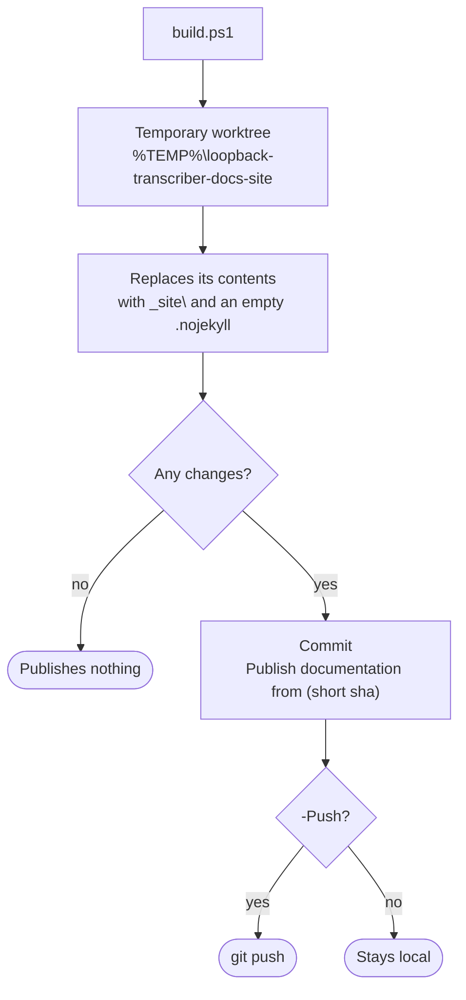

# Documentation

This documentation is generated with **DocFX** in **Spanish and English**. The sources live in `docs\` on the `main` branch. The generated HTML is published to the **`docs-site`** branch, which GitHub Pages serves as a static site.

## Layout

| Path | Contents |
|---|---|
| `.config\dotnet-tools.json` | DocFX as a local tool, with a pinned version. |
| `docs\index.html` | Root page: redirects to `es\` or `en\`. |
| `docs\template\public\main.js` | Language switch link and diagram colors. |
| `docs\template\public\main.css` | Styles for the landing page, the pages and the diagrams. |
| `docs\template-es\token.json` | Template texts in Spanish ("En este artículo", "Siguiente", alerts…). Only the Spanish version uses it. |
| `docs\images\` | Logo and favicon, shared by both languages. |
| `docs\build.ps1` | Builds the whole site into `docs\_site\`. |
| `docs\publish.ps1` | Builds it and publishes it to `docs-site`. |
| `docs\.gitignore` | Excludes `_site\` and `obj\`. |
| `docs\es\`, `docs\en\` | Each version of the site. |

Each language (`es\` and `en\`) has the same layout and the **same file names**:

| Path | Contents |
|---|---|
| `docfx.json` | Build for that language. |
| `toc.yml` | Top menu. |
| `index.md` | Landing page. |
| `guide\` | User guide. |
| `architecture\` | How it works inside. |
| `development\` | Building, tests, installer and this page. |

The language switch link replaces `/es/` with `/en/` in the current address, or the other way round, so it takes you to the same page in the other language. That is why a page must have the same name in both. The chosen language is remembered in the browser. The root page uses it and, the first time, picks based on the browser language: Spanish if it starts with `es`, English otherwise.

## Building and previewing locally

From the repository root:

```powershell
.\docs\build.ps1 -Serve
```

Open <http://localhost:8080>. The script:

1. restores DocFX at the version pinned in `.config\dotnet-tools.json` (`dotnet tool restore`);
2. **`docfx build`** of `es\` and `en\`: each one generates `docs\_site\es\` and `docs\_site\en\` with the `modern` template, search and its language (`_lang`);
3. deletes the JavaScript debugging maps (`*.map`) the template copies: they take about 37 MB, the site does not use them, and they made the GitHub Pages deployment exceed its time limit;
4. copies `index.html` into `docs\_site\`;
5. with `-Serve`, serves `docs\_site\`.

It does not build or analyze the code: it only needs the .NET SDK to run DocFX.

Without `-Serve` it only builds the site.

Diagrams are ` ```mermaid ` blocks, which the `modern` template renders in the browser.

## Publishing to GitHub Pages

### Once: the `docs-site` branch

The branch must be an **orphan**, with no history shared with `main`, so it only contains the HTML. If a `docs-site` created from `main` already exists, delete it first:

```powershell
git push origin --delete docs-site
git branch -D docs-site
```

You do not need to create it by hand: if it does not exist, `publish.ps1` creates it as an orphan in a temporary folder, without touching your working copy.

### Every time the documentation changes

```powershell
.\docs\publish.ps1 -Push
```



If the `docs-site` branch does not exist, the worktree creates it as an orphan. When it finishes, the worktree is always removed. The `.nojekyll` file stops GitHub Pages from processing the site with Jekyll, which would drop files and folders starting with `_`.

Without `-Push` it only makes the local commit, so you can review it first with `git log docs-site`. With `-Branch another-branch` it publishes to another branch.

### Once: turning on GitHub Pages

On GitHub, *Settings → Pages → Build and deployment*:

- **Source**: *Deploy from a branch*;
- **Branch**: `docs-site`, folder `/ (root)`, then *Save*.

Within a minute or two the site will be at `https://pgomur.github.io/loopback-transcriber/`, which redirects to `…/es/` or `…/en/`.

> [!NOTE]
> GitHub Pages is free for public repositories. For a private one it requires a paid plan, and the published site is public anyway, except on GitHub Enterprise Cloud.

## Writing pages

- DocFX Markdown: tables, code blocks, `mermaid` and the `> [!NOTE]`, `> [!TIP]`, `> [!IMPORTANT]` and `> [!WARNING]` alerts.
- Links between pages are relative and point to the `.md`: `[Reliability](../architecture/reliability.md)`. DocFX warns if one does not exist.
- **Every change is made in both languages** and in the same commit: the same file in `es\` and in `en\`, with the same name. A new page is added to both `toc.yml` files of its folder.
- If the behavior of a part of the code changes, update its Architecture page in the same commit. This documentation describes concrete values, such as thresholds, timings and paths, and goes stale if it is not maintained.
