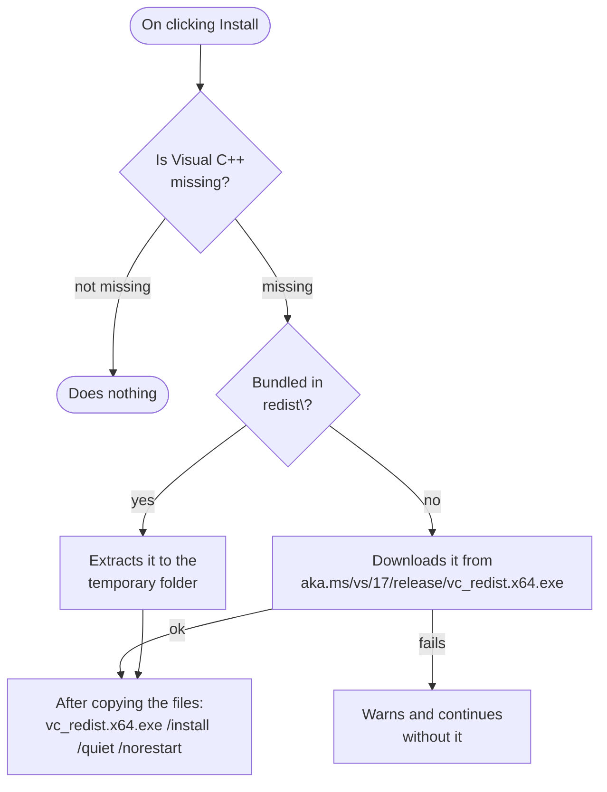

# Installer

The installer is built with **Inno Setup 6** from `installer\LoopbackTranscriber.iss`. It uses features from version 6.3 or later, such as `x64compatible` and the download page.

## Building it

1. [Publish](building.md#publishing) the application to `installer\publish\`.
2. Optional: copy `vc_redist.x64.exe` into `installer\redist\` to bundle it in the installer and not depend on the download. The folder is in `.gitignore`.
3. Compile the script with `ISCC.exe installer\LoopbackTranscriber.iss` (by default in `C:\Program Files (x86)\Inno Setup 6\`), or open it in the Inno Setup IDE and click *Compile*.
4. The result is `installer\Output\LoopbackTranscriberSetup-<version>.exe`.

If `publish\LoopbackTranscriber.exe` does not exist, compilation stops with an error explaining it.

## What the script does

### Version

It is read from the published executable with `GetVersionComponents`:

- `AppVersion` and the file name use `Major.Minor.Revision`, for example `1.1.0`;
- `VersionInfoVersion` uses all four components.

That way the version is only defined in `Directory.Build.props`.

### Installation

| Setting | Value |
|---|---|
| `AppId` | `{B6E1F6C4-6E8B-4A6E-9C2A-6C7B9A9E9C3D}`. It must not change: it identifies the application for upgrades and uninstalling. |
| Destination | `{autopf}\LoopbackTranscriber` |
| Architecture | x64 only, installed in 64-bit mode |
| Minimum Windows version | `10.0.22000` (Windows 11) |
| Wizard languages | Spanish, English, Brazilian Portuguese, German and Russian. It only asks for the language when it does not match Windows, and remembers the one from the previous install. |
| Wizard style | modern, with the application icon |
| Compression | solid LZMA2 *ultra64* |
| `AppMutex` | `Local\LoopbackTranscriber-B6E1F6C4-…`, the same single-instance mutex the application uses. The wizard detects whether it is open and offers to close it (`CloseApplications`). It does not reopen it by itself. |
| `SetupMutex` | Prevents two installers from running at once. |
| Shortcuts | Start menu, and an optional desktop shortcut (unchecked) |
| At the end | offers to launch the application |

### Files

It copies everything in `publish\` **except** what is not used on Windows x64:

- runtimes for `linux-x64`, `vulkan\linux-x64`, `win-arm64` and `win-x86`;
- satellite resources for languages the application does not have: `cs`, `fr`, `it`, `ja`, `ko`, `pl`, `tr`, `zh-Hans`, `zh-Hant`.

The `[InstallDelete]` section deletes those same folders if they were left by an earlier installation.

### Visual C++ Redistributable

Whisper.net and LLamaSharp need the Visual C++ 2015-2022 x64 runtime.

`VCRedistMissing()` treats it as installed if `HKLM64\SOFTWARE\Microsoft\VisualStudio\14.0\VC\Runtimes\x64` has `Installed = 1` and `Minor ≥ 30`.

The exit code of the Visual C++ installer decides what happens next:

| Code | Meaning | Reaction |
|---|---|---|
| `0` | Installed | — |
| `1638` | An equal or newer version was already installed | — |
| `1641`, `3010` | A restart is needed | The wizard offers to restart at the end. |
| Other | Error | Shows the code and the link to install it manually. |

### Uninstalling

After uninstalling, if `%LocalAppData%\LoopbackTranscriber` exists, it asks whether to delete the data too: settings, transcripts, models and unprocessed recordings. The default answer is **No**. If accepted, it deletes that folder and `%TEMP%\LoopbackTranscriber`. Folders the user changed in Settings are not touched. A silent uninstall neither asks nor deletes anything.
