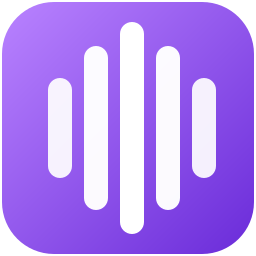

  

    

      
      

        <h1>LoopbackTranscriber</h1>
        
Windows desktop application · Open source (MIT)

      

    

    
Record, transcribe and summarize your meetings without anything leaving your computer.

    
It records the audio of one specific application (Teams, Zoom, Meet in the browser…) together with your microphone. It then transcribes it with Whisper, tells what you say apart from what the others say, and, when you ask for it, writes a summary with a language model. While you record, it can also show the meeting translated in a floating window.

    

      <a class="lt-button lt-button-primary" href="guide/getting-started.md">Getting started</a>
      <a class="lt-button lt-button-secondary" href="architecture/overview.md">How it works inside</a>
      <a class="lt-button lt-button-secondary" href="https://github.com/pgomur/loopback-transcriber">GitHub</a>
    

  

  <aside class="lt-facts">
    <ul class="lt-facts-list">
      <li>
        <i class="bi bi-windows"></i>
        

          System
          64-bit Windows 11
          10.0.22000 or later
        

      </li>
      <li>
        <i class="bi bi-gpu-card"></i>
        

          Acceleration
          Vulkan GPU
          Without one, CPU (slower)
        

      </li>
      <li>
        <i class="bi bi-soundwave"></i>
        

          Transcription
          Whisper large-v3-turbo
          ~624 MB model
        

      </li>
      <li>
        <i class="bi bi-stars"></i>
        

          Summary and translation
          Qwen3-4B
          ~2.5 GB model
        

      </li>
      <li>
        <i class="bi bi-cloud-arrow-down"></i>
        

          Internet
          Only to download models
          Everything else is local
        

      </li>
      <li>
        <i class="bi bi-code-slash"></i>
        

          Built with
          WPF · .NET 10
          MVVM pattern
        

      </li>
      <li class="lt-fact-wide">
        <i class="bi bi-translate"></i>
        

          Languages
          ES EN PT DE RU
          Interface, meetings (or automatic detection) and translation
        

      </li>
    </ul>
  </aside>

  <h2 class="lt-section-title">How to use it</h2>
  
<strong>Optional:</strong> open <a href="guide/live-translation.md">live translation</a> to follow the meeting translated while you record.

<ol class="lt-steps">
  <li>
    <h3>Pick the application</h3>
    
Teams is built in. Zoom, the browser or others are added in <strong>Applications</strong>.

    <a class="lt-step-link" href="guide/applications.md">See the guide</a>
  </li>
  <li>
    <h3>Record</h3>
    
Press <strong>Start recording</strong> (or use the tray icon). The application, the default audio output and your microphone are recorded at the same time.

    <a class="lt-step-link" href="guide/recording.md">See the guide</a>
  </li>
  <li>
    <h3>Get the transcript</h3>
    
When you press <strong>Stop recording</strong>, Whisper transcribes it and, if your microphone was recorded, separates <strong>Participants</strong> from <strong>You</strong>. It is saved in the history.

    <a class="lt-step-link" href="guide/transcripts.md">See the guide</a>
  </li>
  <li>
    <h3>Summarize</h3>
    
In the <strong>AI summary</strong> tab, press <strong>Summarize</strong>: title, key points, goals and next steps.

    <a class="lt-step-link" href="guide/transcripts.md">See the guide</a>
  </li>
</ol>

  <h2 class="lt-section-title">Features</h2>
  
Each feature links to its user guide and its technical explanation.

  

    <h3>Per-application recording</h3>
    
Only the audio of the chosen program, plus your microphone on a separate track. If that track turns out silent, it uses the default audio output.

    
<a href="guide/recording.md">Guide</a> · <a href="architecture/audio-capture.md">Technical</a>

  

  

    <h3>Any application</h3>
    
Teams is built in. Add Zoom, Discord or the browser (for Meet) from the processes that are playing audio.

    
<a href="guide/applications.md">Guide</a> · <a href="architecture/audio-capture.md">Technical</a>

  

  

    <h3>Transcription with Whisper</h3>
    
Whisper <code>large-v3-turbo</code>, on a Vulkan GPU when there is one. Fixed language or automatic detection. Filters hallucinations, repetitions and echo.

    
<a href="guide/settings.md">Guide</a> · <a href="architecture/processing.md">Technical</a>

  

  

    <h3>Who is speaking</h3>
    
Your microphone is transcribed separately and aligned with the meeting. Each paragraph says <strong>Participants</strong> or <strong>You</strong>, with your name in front if you set one.

    
<a href="guide/recording.md">Guide</a> · <a href="architecture/processing.md">Technical</a>

  

  

    <h3>History and search</h3>
    
Search the title, application, date, summary and full text, ignoring case and accents. Filter by date and duration, and transcribe again with the current settings.

    
<a href="guide/transcripts.md">Guide</a> · <a href="architecture/data-on-disk.md">Technical</a>

  

  

    <h3>AI summary</h3>
    
Qwen3-4B writes a title, purpose, key points, topics, goals and next steps, in the application language.

    
<a href="guide/transcripts.md">Guide</a> · <a href="architecture/summary.md">Technical</a>

  

  

    <h3>Live translation</h3>
    
Floating window with what the participants say and its translation into Spanish, English, Portuguese, German or Russian.

    
<a href="guide/live-translation.md">Guide</a> · <a href="architecture/live-translation.md">Technical</a>

  

  

    <h3>Nothing is lost</h3>
    
If something goes wrong (an error, an exit, a shutdown or a crash), the audio is kept as an unprocessed recording so it can be retried.

    
<a href="guide/recording.md">Guide</a> · <a href="architecture/reliability.md">Technical</a>

  

  <h2 class="lt-section-title">Privacy and data</h2>
  
What uses the internet and where your files end up.

  

    <h3>Everything stays on your computer</h3>
    
Audio, transcripts and summaries never leave it. The application only goes online to download the two models, from a fixed Hugging Face revision and checking their SHA256. The installer may also download Microsoft Visual C++ Redistributable if it is missing.

    
Only record with the consent of the people taking part.

    
<a href="architecture/models.md">Models and integrity</a>

  

  

    <h3>Where everything is stored</h3>
    
In <code>%LocalAppData%\LoopbackTranscriber</code>: settings, models, transcripts, unprocessed recordings and log. The models and transcripts folders can be changed in Settings.

    
Each recording is a folder with the text in Markdown (<code>.md</code>) and the audio (<code>.wav</code>), plus, when there are any, your microphone (<code>_mic.wav</code>) and the summary (<code>.summary.json</code>).

    
<a href="architecture/data-on-disk.md">Data on disk</a>

  

  <h2 class="lt-section-title">All the documentation</h2>

  

    <h3>User guide</h3>
    <ul class="lt-doc-list">
      <li><a href="guide/getting-started.md">Getting started</a></li>
      <li><a href="guide/recording.md">Recording a meeting</a></li>
      <li><a href="guide/transcripts.md">Transcripts and summaries</a></li>
      <li><a href="guide/live-translation.md">Live translation</a></li>
      <li><a href="guide/applications.md">Applications</a></li>
      <li><a href="guide/settings.md">Settings</a></li>
      <li><a href="guide/troubleshooting.md">Troubleshooting</a></li>
    </ul>
  

  

    <h3>Architecture</h3>
    <ul class="lt-doc-list">
      <li><a href="architecture/overview.md">Overview</a></li>
      <li><a href="architecture/startup.md">Startup and shutdown</a></li>
      <li><a href="architecture/viewmodels.md">ViewModels and messaging</a></li>
      <li><a href="architecture/audio-capture.md">Audio capture</a></li>
      <li><a href="architecture/processing.md">Processing a recording</a></li>
      <li><a href="architecture/summary.md">Summary</a></li>
      <li><a href="architecture/live-translation.md">Live translation</a></li>
      <li><a href="architecture/workers.md">Worker processes</a></li>
      <li><a href="architecture/models.md">Models and integrity</a></li>
      <li><a href="architecture/reliability.md">Reliability</a></li>
      <li><a href="architecture/localization.md">Localization</a></li>
      <li><a href="architecture/data-on-disk.md">Data on disk</a></li>
    </ul>
  

  

    <h3>Development</h3>
    <ul class="lt-doc-list">
      <li><a href="development/building.md">Building and publishing</a></li>
      <li><a href="development/tests.md">Tests</a></li>
      <li><a href="development/installer.md">Installer</a></li>
      <li><a href="development/documentation.md">Documentation</a></li>
    </ul>
  

