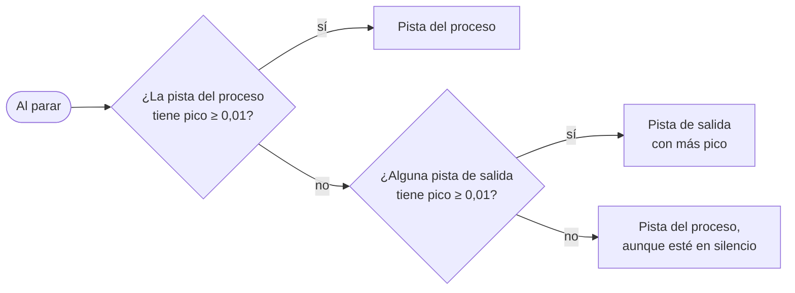

# Captura de audio

`CaptureCoordinator` arranca y para tres grabadores, elige la pista principal al terminar y escribe el fichero de recuperación. Cada grabador implementa una interfaz (`IProcessCapture`, `IDeviceCapture`, `IMicCapture`), y los tests usan dobles en su lugar.

## Los tres grabadores

| Grabador | API | Formato del WAV | Fichero temporal |
|---|---|---|---|
| `ProcessLoopbackRecorder` | WASAPI *process loopback* (COM propio en `Interop/`) | PCM 16 bits, 44,1 kHz, estéreo (`AUTOCONVERTPCM`) | `recording_<fecha>.wav` |
| `DeviceLoopbackRecorder` | `WasapiLoopbackCapture` de NAudio sobre la salida predeterminada, roles *Console* y *Communications* (sin duplicar si son el mismo dispositivo) | El nativo del dispositivo | `recording_<fecha>_console.wav`, `recording_<fecha>_communications.wav` |
| `MicrophoneRecorder` | `WasapiCapture` de NAudio sobre la entrada predeterminada (rol *Multimedia*) | El nativo del dispositivo | `recording_<fecha>_mic.wav` |

Todos escriben en `%TEMP%\LoopbackTranscriber\`, con `<fecha>` = `yyyyMMdd_HHmmss`.

### *Process loopback*

`Wasapi.ActivateProcessLoopbackAsync(pid, includeProcessTree)` activa un `IAudioClient` virtual con `AUDIOCLIENT_ACTIVATION_TYPE_PROCESS_LOOPBACK` y el modo `INCLUDE_TARGET_PROCESS_TREE`. Esta API existe a partir de Windows 10 build 20348.

- El cliente se inicializa en modo compartido con `LOOPBACK | EVENTCALLBACK | AUTOCONVERTPCM | SRC_DEFAULT_QUALITY`.
- Un hilo dedicado (`LoopbackTranscriber-Capture`) espera el evento de muestras y vuelca cada paquete al WAV.
- Además de escribir en disco, cada bloque se publica en el evento `AudioCaptured`, que alimenta la [traducción en vivo](live-translation.md). Solo este grabador lo publica: **la sesión en vivo solo oye a la aplicación**.
- El WAV se abre con `FileShare.ReadWrite | FileShare.Delete` y una cabecera provisional. Los tamaños reales se escriben al parar. Si la aplicación muere antes, la cabecera queda a cero y la repara la [recuperación de huérfanas](reliability.md).
- Al parar, espera al hilo 5 s. Si no termina, para el `IAudioClient` y espera otros 5 s. Si sigue sin terminar, **abandona** la sesión: corrige la cabecera con lo escrito hasta entonces y devuelve el fichero. Un controlador colgado nunca bloquea la aplicación.
- Si la captura terminó con un error pero hay datos, se conserva el audio y se registra un aviso. Sin datos, se lanza `ErrorAudioCapture`.

### Proceso que se graba

`TargetProcessWatcher` revisa cada 1,5 s las aplicaciones vigiladas (`TargetApp.ProcessNames`). Para cada una:

1. `Process.GetProcessesByName` con cada nombre candidato, por ejemplo `ms-teams` y después `Teams`.
2. `ProcessTree.FindRootProcessId` se queda con el proceso raíz de los encontrados.
3. `AudioSessionFinder.FindActiveProcessId` busca entre las sesiones de audio activas una de esos procesos. Si la hay, se usa ese PID.

La pantalla **Aplicaciones** usa `AudioSessionFinder.ListRunningApps()` para listar los procesos que tienen una sesión de audio.

### Huecos de tiempo: `CaptureTimeline`

WASAPI no entrega paquetes cuando no hay nada sonando. Si se escribieran sin más, el WAV se acortaría y las pistas se desalinearían. `CaptureTimeline` compara la marca de tiempo de cada paquete (QPC) con las muestras ya escritas:

- Si faltan más de **250 ms**, rellena con silencio (`WriteSilence`) antes del paquete.
- Guarda `FirstSampleTimestamp`, el instante de la primera muestra, que sirve para alinear el micrófono.
- Los paquetes con `AUDCLNT_BUFFERFLAGS_TIMESTAMP_ERROR` no se usan para medir huecos. Los dispositivos de NAudio, que no dan marca de tiempo, usan la hora de llegada menos la duración del paquete.

## Arranque (`StartAsync`)

1. Genera `baseName = recording_<fecha>` y lo marca como **propio**, para que la recuperación de huérfanas no lo toque mientras se graba.
2. Arranca la captura del proceso. Si falla, la grabación no empieza y el error llega al usuario.
3. Escribe `recording_<fecha>.session.json` con la aplicación y la hora. Si no puede, avisa con `WarningRecoveryFileNotWritten`.
4. Arranca la captura del dispositivo. Si falla, se registra y se sigue sin ella.
5. Arranca el micrófono. Si falla, avisa con `WarningMicNotRecorded`.
6. Reescribe el `.session.json` con las horas de inicio de cada pista.

## Parada (`StopAsync`)

Para las tres capturas: el proceso primero y después el dispositivo y el micrófono, cada una en el *thread pool*. El fallo de una no impide parar las otras. El micrófono espera como mucho 3 s el `RecordingStopped`, y lo mismo cada canal del dispositivo. Después:

### Elección de la pista principal

El umbral es `CaptureCoordinator.DeviceSignalThreshold = 0.01`, en escala de 0 a 1. Si la pista del micrófono no supera ese mismo umbral, `MicrophoneRecorder` la borra al parar.

### Desfase del micrófono

La pista del micrófono empieza en otro instante que la principal. El desfase (`MicStartOffset`) se calcula:

1. con las marcas de la primera muestra de cada pista (`FirstSampleTimestamp`), si las dos existen;
2. si no, con la diferencia entre las horas de inicio de cada captura.

El resultado es un `StoppedRecording`: pista principal, micrófono, desfase, todas las rutas, el error de parada si lo hubo, el `baseName` y los avisos.

## Después del procesado

- **Si tuvo éxito**, `DeleteOriginals` borra todos los WAV temporales y el `.session.json`, y libera el `baseName`.
- **Si falló**, `PreserveFailed` mueve la pista principal y el micrófono a `FailedRecordingStore`. Si ni eso es posible, los originales se quedan en la carpeta temporal y la recuperación los encontrará en el siguiente arranque.
- Cada vez que se ejecuta `DeleteOriginals`, llama también a `DeleteStaleRecordings`, que borra los `recording_*.16k.wav` (ficheros derivados para Whisper) con más de 7 días que hayan quedado en la carpeta temporal.
