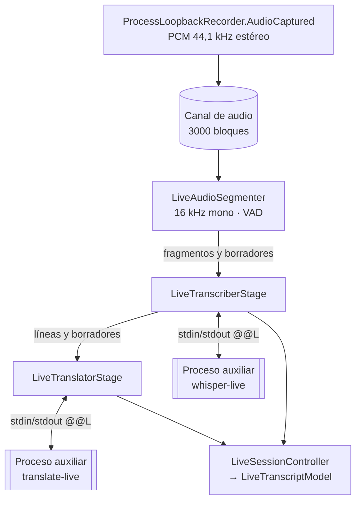

# Traducción en vivo

La sesión en vivo (`LiveTranscriptionSession`) transforma el audio de la aplicación, mientras se graba, en líneas transcritas y traducidas. Es independiente de la transcripción final: no modifica la grabación ni su resultado.

## Tuberías

`LiveSessionController.Start` crea la sesión con:

- Whisper: el mismo modelo que la transcripción final, el idioma de las reuniones (`ResolveMeetingLanguage`), GPU, y `LiveAudioContext` y `LiveFlashAttention` de los ajustes.
- Traductor: el modelo de resumen, si existe, con `núcleos / 2` hilos entre 2 y 6. Si no existe, la sesión solo transcribe.

Los eventos de la sesión llegan desde hilos de fondo. El controlador los pasa al hilo de la interfaz y descarta los de una sesión que ya no es la actual.

## 1. Segmentación (`LiveAudioSegmenter`)

Recibe PCM de 16 bits a 44,1 kHz en estéreo, mezcla a mono y remuestrea a **16 kHz** promediando. Trabaja en **tramas de 20 ms** (320 muestras): una trama es voz si su nivel supera **−42 dBFS**.

| Regla | Valor |
|---|---|
| Pre-roll al detectar voz | 10 tramas (200 ms) |
| Fin de fragmento por pausa | 30 tramas (600 ms) de silencio, o 15 tramas (300 ms) si el fragmento ya dura 3 s |
| Voz mínima para emitir un fragmento | 20 tramas (400 ms) |
| Silencio que se conserva al final | hasta 10 tramas (200 ms) |
| Longitud máxima | 500 tramas (10 s). Se corta en la trama más silenciosa de los últimos 3 s. |
| Borrador | si el fragmento lleva al menos 25 tramas de voz y: han pasado 40 tramas (800 ms) desde el último borrador sin llegar a 10 tramas seguidas de silencio, o se llega justo a 8 tramas de silencio con más de 3 tramas de voz nuevas desde el último borrador |

Un **borrador** es el fragmento en curso, todavía abierto, que se transcribe para mostrar texto provisional. Cada borrador lleva un número de secuencia (`DraftSeq`). Si el fragmento final cubre exactamente el último borrador (con 3 tramas de voz de tolerancia), lo indica para reutilizar su texto.

## 2. Transcripción (`LiveTranscriberStage`)

Usa un `LiveWorkMailbox`: una cola acotada de **8 fragmentos finales** que descarta los más antiguos si se llena, más **un único hueco de borrador** en el que el último sustituye al anterior.

- **Prioridad.** Los fragmentos finales van antes que los borradores. La excepción es que el borrador pendiente sea justo el que precede a ese final.
- **Generaciones.** Cada fragmento final avanza un contador (`LiveGeneration`). Un borrador transcrito cuando ya ha llegado un final más nuevo se descarta, para no mostrar texto antiguo encima del nuevo.
- **Reutilización.** Si un final cubre el último borrador transcrito, se usa su texto sin volver a llamar a Whisper. Las métricas lo marcan como `chunk-reused`.
- Un final igual al anterior, sin distinguir mayúsculas, no se repite.
- `LiveTextSplitter` divide cada línea final: si tiene **90 caracteres o más**, la corta en los finales de frase (`.`, `!`, `?`, `…`) en trozos de al menos 28 caracteres.

El *worker* `whisper-live` mantiene el modelo cargado durante toda la sesión. Cada petición lleva el PCM de 16 kHz en base64. El *worker* lo completa con silencio hasta 1 s si es más corto y aplica los mismos filtros de segmento que la transcripción final, con umbral de no-voz 0,6.

## 3. Traducción (`LiveTranslatorStage`)

Usa otra cola, de **6 líneas**, con un hueco de borrador. Una línea descartada por cola llena se marca como **no traducida** (`TranslationSkipped`) en lugar de quedarse esperando.

- Cada línea se traduce con la **línea anterior como contexto**, que no se traduce.
- Los borradores también se traducen, para mostrar la traducción provisional. Si la línea final no se ha dividido y coincide con el último borrador ya traducido, se reutiliza esa traducción (`translation-reused` en las métricas).
- Cambiar el idioma de destino afecta a lo que se encole a partir de ese momento.

El *worker* `translate-live` carga Qwen3-4B con 2048 tokens de contexto, temperatura 0,2, top-k 20 y top-p 0,9, con un máximo de tokens que depende de la longitud del texto (entre 64 y 400). El *prompt* le pide ser un intérprete que solo devuelve la traducción. Incluye `/no_think` y un bloque `<think>` vacío ya rellenado, para que Qwen3 no razone antes de responder. Antes de anunciarse como listo, traduce una frase de prueba para calentar el modelo.

## 4. Supervisión de los procesos (`LiveWorkerSupervisor`)

| Situación | Reacción |
|---|---|
| El *worker* responde con `Error` a una petición | Se registra y se salta ese fragmento o línea. |
| Se agota el tiempo (60 s para Whisper, 30 s para traducir) o el proceso muere | Se reinicia el *worker*, como máximo **3 veces** por sesión. |
| El *worker* no está listo en 180 s | La sesión informa del error. |
| Más fallos | La ventana muestra el error. La grabación sigue sin cambios. |

## Métricas

Cada fragmento y cada traducción se escriben en `%LocalAppData%\LoopbackTranscriber\live-metrics.log`.

Cada línea empieza con la fecha y la hora:

| Línea | Campos |
|---|---|
| `chunk` (o `chunk-reused` si reutiliza el borrador, `draft` si es un borrador) | `audio` segundos de audio · `whisper` segundos de proceso · `rtf` proceso entre audio · `latency` retraso desde que se dejó de hablar · `queue` fragmentos en cola · `dropped` descartados · `chars` caracteres |
| `translation` (o `draft-translation`) | `chars` caracteres · `model` segundos de traducción · `latency` retraso · `queue` líneas en cola |
| `translation-reused` | `chars` caracteres |

Al cerrar la sesión se añade una línea `SUMMARY` con el modelo, si se usó la GPU, el contexto de audio, *flash attention*, los fragmentos descartados y reutilizados, y los percentiles 50 y 90 de latencia de fragmentos, borradores y traducciones. La ventana muestra los mismos datos en su franja técnica (`LiveMetricsPresenter`).

## Descarte de audio

El canal de entrada guarda como máximo 3000 bloques y descarta los más antiguos. Esto solo ocurre si el segmentador se bloquea, lo que no debería pasar porque solo hace cálculo en memoria. El primer descarte se registra una vez en `app.log`.
