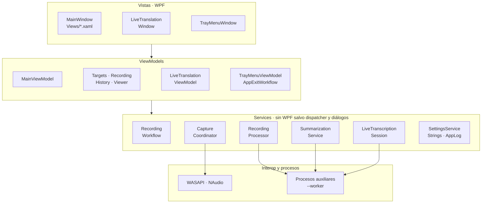

# Visión general

LoopbackTranscriber es un único proyecto WPF (`LoopbackTranscriber.csproj`, `net10.0-windows`) con un proyecto de tests (`LoopbackTranscriber.Tests`). Sigue MVVM con CommunityToolkit.Mvvm y un contenedor de Microsoft.Extensions.DependencyInjection.

## Capas

| Carpeta | Contenido |
|---|---|
| `Views/`, `MainWindow*.cs`, `Converters/`, `Styles/` | XAML y *code-behind*. Solo presentación: ventana, bandeja, calendario, ventana flotante. |
| `ViewModels/` | Estado y comandos de cada pantalla. No conocen las vistas. |
| `Services/` | Lógica: captura, procesado, transcripción, resumen, sesión en vivo, persistencia, localización y registro. |
| `Models/` | Datos simples: ajustes, aplicaciones vigiladas, elementos del historial, etiquetas de hablante. |
| `Interop/` | Interfaces COM de WASAPI, activación del *process loopback*, sesiones de audio y árbol de procesos. |
| `Build/` | `LocalizationCheck.targets`: comprobación de traducciones en compilación. |
| Raíz | `Program`, `App`, `AppServices` (contenedor), `CrashHandler`, `SingleInstance`. |

## Principios de diseño

**Nada sale del equipo.** El único acceso a la red es la descarga de los dos modelos, desde revisiones fijas de Hugging Face y con su SHA256 comprobado. Ver [Modelos e integridad](models.md).

**No se pierde audio.** Una grabación que no se puede transcribir se conserva para reintentarla, también si la aplicación se cierra, se cuelga o se apaga el equipo. Ver [Fiabilidad](reliability.md).

**La inferencia va en procesos aparte.** Whisper y LLamaSharp reservan memoria nativa y de GPU que no siempre se libera al descargar el modelo. Cada transcripción y cada resumen se ejecutan en un proceso hijo que termina al acabar. Así la aplicación principal se mantiene ligera mientras espera en la bandeja. Ver [Procesos auxiliares](workers.md).

**Los servicios no dependen de WPF.** `RecordingWorkflow`, `RecordingProcessor`, `CaptureCoordinator` y las piezas de la sesión en vivo (segmentador, cola de trabajo, división de líneas) se prueban sin ventana. Las dependencias con el sistema (captura, Whisper, conversión de audio, diálogos, dispatcher, vigilante de procesos) están detrás de interfaces que los tests sustituyen por dobles.

**Los ViewModels hijos no se conocen entre sí.** El shell (`MainViewModel`) los coordina y entre ellos se comunican por mensajes. Ver [ViewModels y mensajería](viewmodels.md).

## Dependencias principales

| Paquete | Versión | Uso |
|---|---|---|
| CommunityToolkit.Mvvm | 8.4.2 | `ObservableObject`, `[ObservableProperty]`, `[RelayCommand]`, `WeakReferenceMessenger`. |
| Microsoft.Extensions.DependencyInjection | 10.0.0 | Contenedor de servicios. |
| WPF-UI | 4.3.0 | Tema oscuro, color de acento y controles Fluent. |
| NAudio | 2.2.1 | Captura del dispositivo y del micrófono, lectura, escritura y conversión de WAV. |
| Whisper.net (+ Runtime, Runtime.Vulkan) | 1.9.1 | Reconocimiento de voz, en CPU o en GPU con Vulkan. |
| LLamaSharp (+ Backend.Cpu, Backend.Vulkan) | 0.27.0 | Resumen y traducción con Qwen3-4B. |

## Ajustes de ejecución

El `.csproj` desactiva el GC concurrente y el *Tiered PGO*, y fija `System.GC.ConserveMemory=5`. Todo va encaminado a reducir la memoria residente de una aplicación que pasa la mayor parte del tiempo en la bandeja. Además:

- `MemoryTrimmer.Release()` compacta el *heap* y recorta el *working set*: tras cada transcripción y cada resumen, al terminar de procesar una grabación, al minimizar u ocultar la ventana y una vez 4 s después de mostrarse por primera vez.
- `BackgroundMemoryTrimmer` recorta el *working set* cada 5 minutos mientras la ventana está minimizada u oculta en la bandeja.
