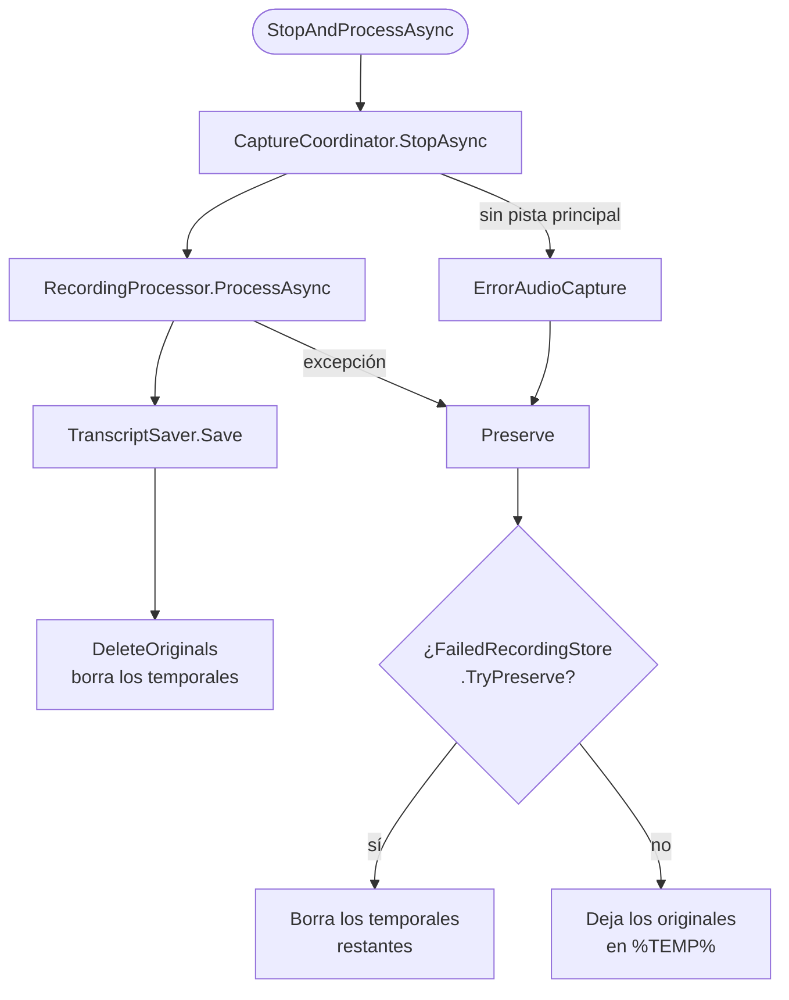

# Procesado de una grabación

## El flujo: `RecordingWorkflow`

`RecordingWorkflow` no depende de WPF. Encadena la captura, el procesado y el guardado, y decide qué hacer con el audio si algo falla. `RecordingViewModel` solo traslada el resultado (`RecordingResult`) a propiedades.

| Método | Uso |
|---|---|
| `StartAsync(pid, appName)` | Arranca la captura. Devuelve los avisos de arranque, como el micrófono no grabado. |
| `StopAndProcessAsync(appName, recordedAt, callbacks)` | Parada normal: procesa, guarda y limpia. Si falla, conserva el audio. |
| `StopAndPreserveAsync(appName, recordedAt, reason)` | Para y conserva **sin procesar**. Se usa al salir, al apagar y en errores. |
| `RetryAsync(failedRecording, callbacks)` | Procesa una grabación conservada. Si sale bien, la borra del almacén. |
| `ListFailed()` / `DiscardFailed(recording)` | Grabaciones sin procesar. |
| `RecoverOrphans()` | Recuperación al arrancar. Ver [Fiabilidad](reliability.md). |

El resumen **no** forma parte de este flujo: se genera a mano desde el visor.

## El procesado: `RecordingProcessor`

`ProcessAsync(sourceWav, micWav, micStartOffset, settings, callbacks)` recibe las pistas y devuelve el texto final. Usa `IWhisperTranscriber` e `IAudioPreparer`, que los tests sustituyen.

1. **Modelo.** `EnsureModelDownloadedAsync` comprueba el modelo y lo descarga si falta. Estado: «*Comprobando el modelo de transcripción...*».
2. **Conversión.** Las dos pistas se convierten a WAV PCM 16 bits, **16 kHz, mono** (`AudioConverter.ConvertToWhisperFormat`: mezcla a mono al 50 % y remuestreo WDL) en `<nombre>.16k.wav`.
3. **Puerta de ruido en el micrófono.** `ApplyNoiseGate` silencia las ventanas de 50 ms cuyo nivel RMS queda **más de 34 dB por debajo del pico** de la pista, con fundidos de 10 ms en cada cambio. Si falla, se transcribe sin filtrar.
4. **Transcripción** de las dos pistas (ver abajo). El progreso combinado es la media de las dos.
5. **Actividad del micrófono.** Se descartan los segmentos del micrófono con menos del 15 % de ventanas activas o menos de 0,15 s activos (`GetActivityMap`, ventanas de 50 ms).
6. **Filtro de eco** entre el micrófono y la aplicación (ver abajo).
7. **Composición** del texto con etiquetas de hablante.
8. Si el texto sale vacío y el audio dura **20 s o más**, se lanza `ErrorNoTextInAudio`: la grabación se conserva como fallida. Si dura menos, se devuelve el texto vacío: `TranscriptSaver` no guarda nada y `RecordingWorkflow` borra los temporales como en cualquier grabación terminada.
9. Los `.16k.wav` se borran siempre al terminar, en un `finally`.

### Idioma

| `MeetingLanguage` | Pista de la aplicación | Micrófono | Ejecución |
|---|---|---|---|
| `""` (por defecto) | idioma de la aplicación | igual | En paralelo, cada una con la mitad de hilos. |
| `es`, `en`, `pt`, `de`, `ru` | ese | ese | En paralelo. |
| `auto` | detectado | **el detectado en la aplicación** | En serie: primero la aplicación y luego el micrófono con ese idioma. |

La detección (`LanguageDetector`) mide el nivel de cada segundo de la pista y prueba ventanas de 30 s, empezando cada 5 s. Se queda con las 3 que tienen más segundos activos, con al menos 8 y sin solaparse. En cada una llama a `DetectLanguageWithProbability` de Whisper y suma la probabilidad del idioma devuelto. La confianza es la suma del idioma ganador dividida entre el número de ventanas. Si no llega a **0,5**, se usa el idioma de la aplicación. El resultado se registra en `app.log`.

### Whisper (`WhisperTranscriptionService`)

- Una pista **en silencio** (pico ≤ −50 dBFS) devuelve 0 segmentos sin arrancar ningún proceso.
- Cada transcripción se ejecuta en un **proceso auxiliar** `whisper`. Ver [Procesos auxiliares](workers.md).
- Hilos por instancia: `núcleos / 2 / transcripciones simultáneas`, entre 2 y 16.
- Parámetros: sin contexto entre segmentos (`WithNoContext`), umbral de no-voz **0,6** (0,45 para el micrófono, modo estricto) y probabilidades activadas. GPU con Vulkan si la hay.

Filtros por segmento (`FilterSegmentText`), en orden:

1. Descarta etiquetas de no-voz como `[MUSIC]` o `(applause)` y textos sin letras ni números.
2. Descarta los segmentos con probabilidad de no-voz ≥ 0,6 (≥ 0,45 en modo estricto).
3. Descarta frases típicas de alucinación («thank you», «gracias por ver el video», «subtítulos realizados por la comunidad de amara.org»…) si su probabilidad de no-voz es ≥ 0,3 (≥ 0,2 en modo estricto).
4. Descarta el texto escrito en otro alfabeto que el del idioma: un 30 % de letras o más fuera de él. Solo se aplica a idiomas de alfabeto latino o cirílico. Con el idioma sin determinar no se aplica.
5. Elimina frases repetidas en bucle (`RemovePhraseLoops`) y descarta las repeticiones de una misma palabra (`IsRepeatedWordLoop`).

Sobre el conjunto: `RemoveRepeatedSegments` quita los segmentos repetidos y `MergeCloseSegments` une los separados por **2 s o menos** hasta 400 caracteres.

### Filtro de eco (`MeetingEchoFilter`)

Con altavoces, el micrófono capta también a los participantes, y con auriculares la aplicación a veces devuelve tu propia voz. Para cada segmento del micrófono de **3 palabras o más**:

1. Busca los segmentos de la aplicación que se solapan, con ±3 s de margen, una vez aplicado el desfase del micrófono.
2. Si comparten al menos el **60 %** de las palabras, son la misma frase. Si no, el segmento se queda tal cual.
3. Decide **quién habló primero**. El micrófono es el original si empieza **300 ms o más antes**, o si empieza a menos de 150 ms y es **fuerte**. Fuerte significa que su percentil 75 de nivel está a menos de 10 dB del percentil 90 de toda la pista (`MicLoudness`).
4. Si el micrófono es el original, se conserva y se quitan de la aplicación los segmentos contenidos en él en un 60 % o más. Si no, se descarta el del micrófono como eco.

### Composición (`TranscriptComposer`)

- Ordena todos los segmentos por inicio. Los del micrófono se desplazan con `MicStartOffset`.
- Empieza un párrafo nuevo cuando cambia quien habla, tras una pausa de **3 s o más**, o cuando el párrafo pasa de **700 caracteres**.
- Si hay algún segmento del micrófono, cada párrafo empieza con la etiqueta: `Participantes:`, `Tu:` o `<nombre> (Tú):`. Si no, el texto va sin etiquetas.

Las etiquetas se guardan **siempre en español** (`SpeakerLabels`) para que el fichero no dependa del idioma de la interfaz. El visor las traduce al mostrarlas (`SpeakerDisplay`).

## El guardado: `TranscriptSaver`

Escribe en `<TranscriptsFolder>\<App>\<App>_<yyyyMMdd_HHmmss>\`:

| Fichero | Contenido |
|---|---|
| `<base>.md` | La cabecera `# <App> - dd/MM/yyyy HH:mm`, una línea en blanco y el texto. |
| `<base>.wav` | Copia de la pista principal. |
| `<base>_mic.wav` | Copia del micrófono, si lo hay. |
| `<base>.recording.json` | `MicStartOffsetTicks`, solo si hay micrófono. |

`<App>` es el nombre de la aplicación sin los caracteres no válidos en un nombre de fichero, que se sustituyen por `_` (`TranscriptHistoryService.GetAppFolderName`). Si el texto está vacío, no se guarda nada.

## Re-transcripción (`TranscriptRetranscriber`)

1. Toma `<base>.wav`, `<base>_mic.wav` si existe y el desfase de `<base>.recording.json`, o 0 si no lo hay.
2. Ejecuta `RecordingProcessor.ProcessAsync` con los ajustes actuales, en una carpeta de trabajo `%TEMP%\LoopbackTranscriber\retranscribe\<guid>` que se borra al acabar.
3. Reescribe el `.md` conservando su cabecera. Las transcripciones antiguas en `.txt` se reescriben como `.txt`.
4. A diferencia de una grabación nueva, un resultado vacío es siempre un error, sin importar la duración.
