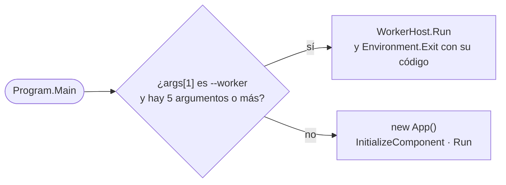

# Arranque y cierre

## Punto de entrada

`Program.Main` (`[STAThread]`) decide primero si el proceso es la aplicación o un **proceso auxiliar**:

Un proceso auxiliar **nunca crea `App` ni ventanas**.

`App.xaml` se declara como `Page` y no como `ApplicationDefinition` (lo hace el `.csproj`) para que el `Main` sea este y no el generado por WPF. Así un proceso auxiliar arranca sin cargar nada de la interfaz. Ver [Procesos auxiliares](workers.md).

## `App.OnStartup`

En este orden:

1. **`CrashHandler.Install`** se suscribe a `DispatcherUnhandledException`, `AppDomain.UnhandledException` y `TaskScheduler.UnobservedTaskException`. Va lo primero para cubrir también el propio arranque.
2. **`SingleInstance.TryAcquire`** toma el mutex `Local\LoopbackTranscriber-B6E1F6C4-…`. Si ya lo tiene otra instancia, le señala el evento `…-Activate` (con `AllowSetForegroundWindow` para que pueda pasar al frente) y esta termina. Un mutex abandonado por una instancia que se cerró de golpe se toma igualmente.
3. **Ajustes**: crea `UserNotices` y `SettingsService`. `EnsureDefaultUserName()` propone el nombre de Windows la primera vez y se fija el idioma con `Strings.Instance.SetLanguage(...)`.
4. **Tema**: WPF-UI en oscuro, con el acento `#6A2BD9`.
5. **Contenedor**: `AppServices.Build(settings, notices)` registra todos los servicios y ViewModels y valida el grafo al construirlo (`ValidateOnBuild = true`).
6. Resuelve `MainWindow`, la registra en `CrashHandler.Attach` junto con `RecordingViewModel` para poder rescatar la grabación, empieza a escuchar las activaciones de otras instancias y muestra la ventana.

El constructor de `MainWindow` llama a `MainViewModel.Start()`, que:

- arranca el vigilante de procesos (`TargetsViewModel.Start`);
- carga el historial;
- lanza en segundo plano la **recuperación de grabaciones huérfanas** y la **verificación de los modelos instalados**.

## El contenedor (`AppServices`)

Todo es *singleton* salvo los ViewModels de las páginas secundarias, que son *transient* y se crean bajo demanda a través de `IPageFactory`:

| Registro | Implementación |
|---|---|
| `ISettingsStore` | `SettingsService` (creado antes del contenedor) |
| `UserNotices` | instancia compartida de avisos para el usuario |
| `ITargetWatcher` | `TargetProcessWatcher` |
| `ICustomAppsService` | `CustomAppsService` |
| `ISummarizer` | `SummarizationService` |
| `IModelVerifier` | `ModelVerifier` |
| `IWhisperTranscriber` | `WhisperTranscriptionService`, que también se registra con su propio tipo |
| `IAudioPreparer` | `NaudioAudioPreparer` |
| `TranscriptHistoryService`, `TranscriptsFolderWatcher` | — |
| `RecordingProcessor`, `TranscriptSaver`, `TranscriptRetranscriber` | — |
| `FailedRecordingStore` | carpeta `%LocalAppData%\LoopbackTranscriber\failed` |
| `CaptureCoordinator` | con `ProcessLoopbackRecorder`, `DeviceLoopbackRecorder`, `MicrophoneRecorder` y el `FailedRecordingStore` |
| `RecordingWorkflow` | — |
| `IDialogService` | `WpfDialogService` |
| `IUiDispatcher` | `WpfUiDispatcher.Instance` |
| `IMessenger` | `WeakReferenceMessenger.Default` |
| ViewModels del shell | `HistoryViewModel`, `ViewerViewModel`, `TargetsViewModel`, `RecordingViewModel`, `MainViewModel` |
| `IRecordingHost` | `RecordingHost` |
| `ILiveTranslationFactory` | `LiveTranslationFactory` |
| Otros | `TrayMenuViewModel`, `AppExitWorkflow`, `UserNoticePresenter`, `MainWindow` |
| *Transient* | `FirstRunViewModel`, `ConfigViewModel`, `ApplicationsViewModel`, `LiveTranslationSettingsViewModel` |
| `IPageFactory` | `ServiceProviderPageFactory`, que los resuelve del contenedor |

## Primera ejecución o aplicación

El constructor de `MainViewModel` comprueba si existen los dos modelos, `models\whisper\ggml-turbo.bin` y `models\llm\Qwen3-4B-Q4_K_M.gguf`:

- Si existen, marca `FirstRunSetupCompleted`, selecciona la primera aplicación y muestra `AppView`.
- Si no, crea `FirstRunViewModel` y muestra `FirstRun`. Al completarse, abre `Config`.

Si la verificación de arranque borra un modelo dañado, se vuelve a `FirstRun`, salvo que haya una grabación en curso o procesándose.

## Cierre

Hay cuatro formas de que termine la aplicación. Ninguna borra audio sin procesar.

| Situación | Qué ocurre |
|---|---|
| **X de la ventana** | `Closing` se cancela y la ventana se oculta en la bandeja (`HideToTray`). |
| **Salir** desde la bandeja | `AppExitWorkflow.ConfirmExitAsync` decide (ver abajo). Si se genera un resumen, se pide confirmación porque se perdería. |
| **Cierre de sesión o apagado de Windows** | `SessionEnding` permite el cierre y llama a `RecordingViewModel.PreserveInterruptedRecording(3 s)`: para la captura y conserva el audio sin procesar. |
| **Error no controlado** | `CrashHandler` conserva la grabación (3 s), muestra el mensaje con la ruta del registro y cierra con código 1. |

### `AppExitWorkflow`

1. Espera, como mucho 10 s, a que termine de arrancar una grabación a medio iniciar.
2. **Con una grabación en curso**, pregunta Sí / No / Cancelar:
   - *Sí*: muestra la ventana, para y procesa (`IRecordingHost.StopRecordingAsync`) y sale.
   - *No*: conserva el audio sin procesar (`PreserveInterruptedRecordingAsync`, 10 s como máximo) y sale.
   - *Cancelar*: no sale.
3. **Con una grabación procesándose**, pregunta si esperar. Si se acepta, muestra la ventana y espera a que `IsBusy` pase a `false`.
4. Mientras una salida está pendiente, se ignoran otras peticiones de salir.

### `App.OnExit`

Libera el contenedor, que libera grabadores, vigilantes y temporizadores. Después escribe los ajustes que no se pudieron guardar (`FlushPendingWrite`) y suelta el mutex de instancia única.

## `CrashHandler`

| Evento | Tratamiento |
|---|---|
| `DispatcherUnhandledException` (hilo de la interfaz) | Lo marca como gestionado, lo registra, rescata la grabación, muestra `CrashBody`, `CrashBodyPreserved` o `CrashBodyLost` y cierra la aplicación. |
| `AppDomain.UnhandledException` (otro hilo) | Lo registra, rescata la grabación en el hilo de la interfaz (con 2 s para que responda) y muestra el mismo mensaje. El proceso termina igualmente. |
| `UnobservedTaskException` | Solo lo registra y lo marca como observado. |

Un segundo error mientras se gestiona el primero solo se registra.
