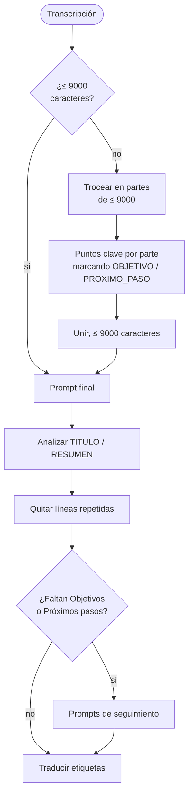

# Resumen

`SummarizationService` implementa `ISummarizer`. `ViewerViewModel` lo invoca con el texto de la transcripción, la ruta del modelo y el idioma de la interfaz. El resultado (`RecordingSummary`: `Title` y `Summary`) se guarda en `<base>.summary.json`.

## Dónde se ejecuta

`SummarizeAsync` serializa un `SummaryJob` (`TranscriptText`, `ModelPath`, `UiLanguage`) y lo ejecuta en un proceso auxiliar `summary`. El progreso llega como `@@P <porcentaje>`. Dentro del proceso auxiliar, `SummarizeInProcessAsync` hace el trabajo real. Al terminar el proceso se libera toda la memoria del modelo. Ver [Procesos auxiliares](workers.md).

## Modelo y parámetros

| Parámetro | Valor |
|---|---|
| Modelo | `Qwen3-4B-Q4_K_M.gguf` (ver [Modelos e integridad](models.md)) |
| Contexto | 8192 tokens |
| Capas en GPU | todas (`GpuLayerCount = 999`), con el *backend* Vulkan si está disponible; si no, CPU |
| Hilos | `núcleos / 2`, entre 2 y 6 |
| Ejecutor | `StatelessExecutor` de LLamaSharp: cada *prompt* es independiente |
| Muestreo normal | temperatura 0,6, top-k 30, top-p 0,9, *repeat penalty* 1,12, *frequency* 0,3, *presence* 0,3, ventana de penalización 512 |
| Muestreo reforzado | temperatura 0,8, *repeat penalty* 1,25, *frequency* 0,6, *presence* 0,5 |
| Parada | `<\|im_end\|>` o `</s>` |

## Proceso

### 1. Condensar si es largo

Si la transcripción supera 9000 caracteres, `SplitIntoChunks` la parte en trozos de 9000 como máximo. A cada trozo se le aplica el *prompt* `Chunk` (máximo 600 tokens), que pide una lista de puntos clave:

- Los objetivos y compromisos llevan la marca `[OBJETIVO]` y las próximas reuniones o seguimientos `[PROXIMO_PASO]`.
- Cada parte se recorta a su cuota de caracteres (`FitPointsToLimit`). Los puntos marcados se conservan siempre, aunque no quepan los demás.
- Las partes se unen bajo `Puntos clave (parte i de N):`. El conjunto se recorta a 9000 caracteres.

### 2. Prompt final

El *prompt* `Final` (máximo 1800 tokens) pide **texto plano** con este formato exacto:

| Etiqueta | Contenido |
|---|---|
| `TITULO:` | El título, en la misma línea. |
| `RESUMEN:` | Marca el comienzo de las secciones. |
| `Proposito:` | Dos o tres frases. |
| `Puntos clave:` | Una línea por punto, empezando por `- `. |
| `Temas:` | Cada tema en una línea `* Tema` y, debajo, sus detalles con `- `. |
| `Objetivos:` | Una línea por objetivo, con `- `. |
| `Proximos pasos:` | Una línea por paso, con `- `. |

Las reglas del *prompt*: escribir en el idioma pedido aunque la transcripción esté en otro, entre 5 y 12 puntos clave, no inventar nada, omitir las secciones vacías y no repetirse. También explica las etiquetas de hablante (`Tu`, `<nombre> (Tú)`, `Participantes`) para que el modelo las use solo cuando aporten algo. Los marcadores `{{SELF}}`, `{{SELF_NAMED}}` y `{{OTHERS}}` se sustituyen con `SpeakerLabels.ApplyToPrompt`.

### 3. Bucles de repetición

Mientras genera, `GenerateAsync` compara cada línea nueva de 5 palabras o más con las 10 líneas anteriores. Dos líneas son casi iguales si su índice de Jaccard sobre las palabras de 3 o más letras es **≥ 0,72**. Si aparecen 3 casi repetidas, corta y **repite la generación con el muestreo reforzado**.

### 4. Análisis de la respuesta (`ParseResult`)

1. Quita el bloque `<think>…</think>` de Qwen3 si lo hay (`StripThinkBlock`).
2. Busca el formato plano `TITULO:` / `RESUMEN:`. Admite tildes, asteriscos y mayúsculas o minúsculas.
3. Si no lo encuentra, busca el primer objeto JSON con `title` y `summary`.
4. Si tampoco, usa la primera línea como título (60 caracteres como máximo) y todo el texto como resumen.

Después `RemoveRepeatedLines` quita las líneas casi duplicadas dentro de cada sección.

### 5. Secciones que faltan

Si el resumen no tiene **Objetivos** o **Próximos pasos**, se pregunta por ellos con los *prompts* `Goals` y `NextSteps` (máximo 300 tokens cada uno) sobre el mismo texto. El modelo responde `NINGUNO` si no hay. Se añaden un máximo de 8 elementos, normalizados como `- …`.

### 6. Etiquetas en el idioma de la interfaz

El modelo escribe siempre las etiquetas en español: `Proposito`, `Puntos clave`, etc. `LocalizeSectionLabels` las sustituye por las claves `SummaryLabel*` del idioma pedido, salvo en español, donde se dejan. Reconoce también variantes que el modelo a veces escribe: con o sin tilde, en singular («Objetivo», «Próximo paso»), «Siguientes pasos» y «Tareas», que tiene su propia etiqueta (`SummaryLabelTasks`) aunque el *prompt* no la pide.

## Cómo se muestra

`ViewerViewModel` pasa el texto guardado por `SummaryFormatter.Parse`, que lo divide en secciones (`SummarySection`) para el visor:

- Reconoce las etiquetas de sección en los cinco idiomas («Puntos clave», «Key points», «Kernpunkte»…) y muestra cada título con el texto del idioma **actual** y su icono. Un resumen generado en español se ve con títulos en inglés si se cambia la interfaz a inglés; el contenido no cambia.
- Las líneas `- …` son viñetas, las líneas `* …` son temas y las viñetas bajo un tema se sangran un nivel.

## Progreso

`ProgressTracker` reparte el 100 % entre la carga del modelo (150 unidades), cada parte (100 de *prefill* más unos 450 tokens esperados) y el *prompt* final (100 más unos 900 tokens). El porcentaje se queda en 99 hasta terminar.

## Restricciones de uso

- No se genera un resumen mientras se graba o se procesa una grabación (`CaptureStateChangedMessage`).
- No se puede empezar a grabar mientras se genera un resumen (`SummaryActivityChangedMessage`).
- Si se cierra la ventana durante un resumen, se pide confirmación.
