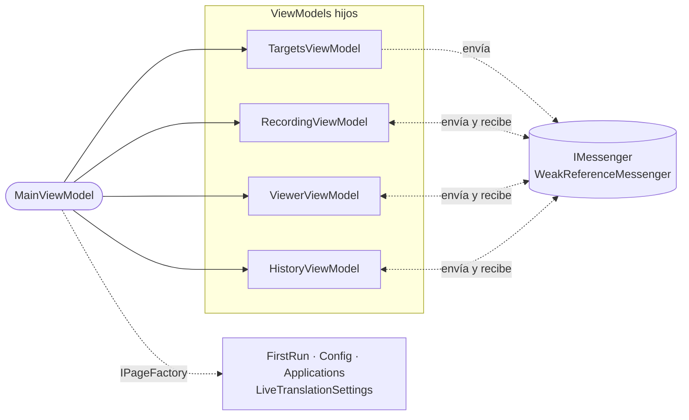

# ViewModels y mensajería

## El shell y sus hijos

`MainViewModel` es solo el **shell**: navegación entre pantallas, selección de aplicación y entradas de la bandeja y de la ventana flotante. Recibe cuatro ViewModels hijos, un `IPageFactory`, `ISettingsStore`, `IMessenger` e `IModelVerifier`. No depende de ningún servicio concreto.

| Hijo | Responsabilidad | Depende de |
|---|---|---|
| `TargetsViewModel` | Aplicaciones vigiladas, su estado (abierta o no, PID), selección y aplicaciones añadidas. | `ITargetWatcher`, `ICustomAppsService` |
| `RecordingViewModel` | Grabar y parar, estado y cronómetro, grabaciones sin procesar de la aplicación seleccionada (reintentar o descartar), recuperación de huérfanas y rescate en cierres. | `RecordingWorkflow`, `IDialogService` |
| `HistoryViewModel` | Historial global y por aplicación, cada uno con su búsqueda (`HistorySearchState`) y sus filtros (`HistoryFilterState`), selección y borrado. Vigila la carpeta con `TranscriptsFolderWatcher`, que agrupa los cambios en 500 ms. | `TranscriptHistoryService` |
| `ViewerViewModel` | Visor (pestañas Transcripción y Resumen), generación y regeneración de resúmenes y re-transcripción. | `ISummarizer`, `TranscriptHistoryService`, `TranscriptRetranscriber` |

**Regla**: el shell llama a los hijos directamente. Los hijos **no se referencian entre sí**: se hablan solo por mensajes.

## Mensajes

Todos se definen en `ViewModels/Messages.cs` y viajan por `WeakReferenceMessenger`. Las suscripciones usan *lambdas* estáticas con el receptor como parámetro, para no capturar `this`, y cada ViewModel se da de baja en `Dispose` con `UnregisterAll`.

| Mensaje | Emisor | Receptores | Significado |
|---|---|---|---|
| `TargetSelectionChangedMessage(Target)` | Targets | Shell, Recording | Cambió la aplicación seleccionada. El shell navega a su vista y Recording la toma como destino. |
| `TargetStatusesSyncedMessage` | Targets | Shell | Se actualizó el estado de las aplicaciones. El shell lo reenvía a Recording, que para la grabación si la aplicación grabada se cerró. |
| `TargetListChangedMessage` | Targets | Shell | Se añadió o quitó una aplicación. |
| `CaptureStateChangedMessage(IsActive)` | Recording | Viewer | Hay una captura o un procesado en curso. Bloquea resúmenes y re-transcripciones. |
| `TranscriptReadyMessage(Text, FilePath)` | Recording | Viewer | Hay una transcripción nueva que mostrar. |
| `RecordingSavedMessage` | Recording, Viewer | History | Cambió algo en disco. History recarga. |
| `TranscriptDeletedMessage(FilePath)` | History | Viewer | Se borró una transcripción. Si estaba abierta, el visor se vacía. |
| `SummaryActivityChangedMessage(IsGenerating)` | Viewer | Recording | Se está generando un resumen. Bloquea empezar a grabar. |
| `FindTranscriptRequest(FilePath)` | Viewer | History | Petición con respuesta: Viewer pide el `TranscriptHistoryItem` de una ruta. |
| `LiveTranslationPreferencesChangedMessage` | Ventana flotante, ajustes en vivo | Ventana flotante, ajustes en vivo | Cambió una preferencia de la traducción en vivo. Ambos se resincronizan. |
| `TranslucentUiChangedMessage(Enabled)` | Config | `MainWindow` | Activar o desactivar la interfaz traslúcida. |

## Páginas secundarias

`IPageFactory` crea bajo demanda `FirstRunViewModel`, `ConfigViewModel`, `ApplicationsViewModel` y `LiveTranslationSettingsViewModel`, que son *transient* en el contenedor. El shell guarda la instancia creada y, al volver a la página, llama a `RefreshFromDisk()`. Al salir de `Config`, llama a `FlushPendingChanges()` para guardar un nombre de usuario a medio escribir.

La navegación es una propiedad `CurrentView` de tipo `MainViewMode` (`FirstRun`, `AppView`, `History`, `Config`, `Applications`, `LiveTranslation`) más una propiedad booleana `Is…Active` por pantalla para los *bindings*.

## `IRecordingHost`: la grabación vista desde fuera

La ventana flotante y el menú de la bandeja necesitan saber si se graba, empezar o parar, y recibir el audio. Pero no deben conocer al shell. `IRecordingHost` expone justo eso:

| Miembro | Uso |
|---|---|
| `IsRecording`, `IsBusy`, `StatusText`, `ElapsedText`, `IsTranscribingActive`, `TranscriptionProgressPercent` | Estado que se muestra. |
| `CanToggleRecording`, `RecordDisabledReason`, `CanStartRecordingFor(target)` | Si se puede grabar y, si no, por qué. |
| `SelectedTarget` | Aplicación seleccionada. |
| `StartRecordingForAsync(target)` | Selecciona la aplicación con `Targets.Select` y solo graba si la selección se aplicó de verdad en Targets y en Recording. |
| `StopRecordingAsync()` | Para y procesa. |
| `AudioCaptured` | Bloques PCM de la pista de la aplicación, para la sesión en vivo. |

`RecordingHost` lo implementa directamente sobre `RecordingViewModel` y `TargetsViewModel`, y reenvía sus `PropertyChanged`.

## La ventana flotante

`LiveTranslationViewModel` contiene solo el estado de la ventana. `LiveTranslationFactory` lo crea para una aplicación concreta (`Create(target, openMainWindow)`) y se apoya en tres piezas:

| Pieza | Responsabilidad |
|---|---|
| `LiveSessionController` | Ciclo de vida de la `LiveTranscriptionSession`: arrancar con los modelos y ajustes actuales, enviar el audio, parar, y pasar los eventos de la sesión al hilo de la interfaz. Descarta los eventos de una sesión que ya no es la actual. |
| `LiveTranscriptModel` | Las líneas mostradas (`LiveLine`), los borradores de transcripción y de traducción y sus reglas: qué se sustituye, qué se marca como no traducido, cuándo se limpia. |
| `LiveMetricsPresenter` | Los textos de la franja de datos técnicos. |

La sesión en vivo se arranca cuando la ventana está abierta **y** se graba su aplicación, sin importar quién inició la grabación. Se para al dejar de grabarla. El funcionamiento de la sesión está en [Traducción en vivo](live-translation.md).

## La bandeja

- `TrayMenuViewModel.Build(actions)` construye las entradas del menú (`TrayMenuEntry`) según el estado:
  - en la primera ejecución, solo *Abrir* y *Salir*;
  - sin grabar, *Iniciar grabación de X* por cada aplicación vigilada, activa solo si se puede grabar, y, si la grabación está bloqueada, el motivo como entrada desactivada;
  - grabando, una línea de estado con el tiempo en directo y *Detener grabación de X*, que además muestra la ventana;
  - siempre, *Traducción en vivo de X* por cada aplicación vigilada, activa solo si está abierta, o, si hay una ventana flotante, solo *Cerrar traducción en vivo de X*.
- Las acciones de grabar o parar se ejecutan con un único `AsyncRelayCommand`. Mientras una está en marcha, las entradas se desactivan y los clics extra se ignoran.
- `TryRunExit` impide lanzar dos salidas a la vez.
- `TryConsumeTrayHint` muestra una sola vez el aviso de «sigue en la bandeja» y lo guarda en los ajustes.
- `TrayIconService` gestiona el icono nativo y `TrayMenuWindow` dibuja el menú.

## Avisos al usuario

Los servicios que no deben mostrar diálogos (ajustes, historial, almacén de fallidas, verificador de modelos) añaden avisos a `UserNotices`. `AddOnce(identidad, …)` evita repetir el mismo aviso. `UserNoticePresenter` empieza a mostrarlos cuando la ventana termina de dibujarse por primera vez. A partir de ahí los muestra en cuanto llegan, todos los pendientes juntos en un único diálogo «Aviso».

## Hilos

Los ViewModels se actualizan en el hilo de la interfaz. Los eventos que llegan de otros hilos (vigilante de procesos, sesión en vivo, progreso de los procesos auxiliares) pasan por `IUiDispatcher` o por `Progress<T>`, que se crea en el hilo de la interfaz.
