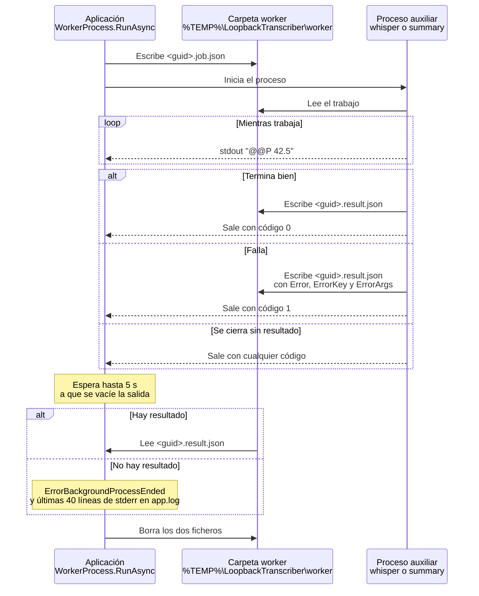

# Procesos auxiliares

Whisper.net y LLamaSharp reservan memoria nativa y de GPU que no siempre se devuelve al sistema al liberar el modelo. Para que la aplicación principal no crezca con cada uso, **toda la inferencia se ejecuta en procesos hijos**: el mismo ejecutable lanzado en modo *worker*.

## Línea de comandos

`LoopbackTranscriber.exe --worker <tipo> <ruta-trabajo> <ruta-resultado> <pid-padre>`

| Argumento | Significado |
|---|---|
| `--worker` | Marca el proceso como auxiliar. |
| `<tipo>` | `whisper`, `summary`, `whisper-live` o `translate-live`. |
| `<ruta-trabajo>` | El fichero JSON con el trabajo. |
| `<ruta-resultado>` | Donde el proceso escribe el resultado. |
| `<pid-padre>` | El PID de la aplicación, para el vigilante del padre. |

`WorkerProcess.CreateStartInfo` la construye a partir de `Environment.ProcessPath`. Si la aplicación se ejecuta con `dotnet LoopbackTranscriber.dll`, por ejemplo desde el depurador, añade la ruta del ensamblado como primer argumento. El proceso se crea sin ventana y con la salida estándar y la de error redirigidas.

`Program.Main` reconoce la invocación con `WorkerHost.IsWorkerInvocation`: el segundo argumento debe ser `--worker` y debe haber al menos 5. En ese caso ejecuta `WorkerHost.Run` y termina **sin crear `App`**.

| Tipo | Modo | Trabajo | Resultado |
|---|---|---|---|
| `whisper` | por lotes | `WhisperJob` | `WhisperJobResult` |
| `summary` | por lotes | `SummaryJob` | `SummaryJobResult` |
| `whisper-live` | persistente | `LiveWhisperConfig` | por stdout |
| `translate-live` | persistente | `LiveTranslatorConfig` | por stdout |

Los ficheros de trabajo se escriben en `%TEMP%\LoopbackTranscriber\worker\` con un GUID por nombre: `<guid>.job.json` y `<guid>.result.json`, o `<guid>.live.json` en los persistentes. Se borran al terminar.

## Vigilante del padre

Si se pasa `<pid-padre>`, el *worker* arranca un hilo en segundo plano que espera a que termine ese proceso. Cuando termina, o si ya no existe, sale con **código 2**. Así ningún *worker* sobrevive a la aplicación, aunque esta muera de golpe.

## Modo por lotes (`whisper`, `summary`)

- **Progreso**: líneas `@@P <número>` en la salida estándar, con cultura invariante y hasta 3 decimales (`WorkerProtocol.FormatProgress` / `TryParseProgress`). Las demás líneas se ignoran.
- **Resultado**: el *worker* escribe el JSON y sale con 0.
- **Error**: si falla, escribe en el fichero de resultado un objeto con `Error` (el mensaje) y, si la excepción tenía una clave de localización, `ErrorKey` y `ErrorArgs`, y sale con 1. La aplicación lo convierte en una excepción con la misma clave (`UserError.FromWorker`), así que el usuario ve el mensaje traducido a su idioma.
- **Sin resultado**: si el proceso termina sin escribir nada (porque se cuelga el controlador o falta el *runtime* de C++), se lanza `ErrorBackgroundProcessEnded` con el código de salida. Las últimas 40 líneas de stderr se escriben en `app.log` (`WorkerStderrTail`).
- **Cancelación**: el `CancellationToken` mata el árbol de procesos.
- Cuando el proceso termina, se espera como mucho 5 s a que se vacíe su salida.

### Contratos JSON

| Tipo | Campos |
|---|---|
| `WhisperJob` | `WavPath`, `ModelPath`, `Language`, `FallbackLanguage`, `ThreadCount`, `StrictNoSpeech`, `UseGpu` |
| `WhisperJobResult` | `Language`, `Segments` (cada uno con `StartTicks`, `EndTicks` y `Text`), `Error`, `ErrorKey`, `ErrorArgs` |
| `SummaryJob` | `TranscriptText`, `ModelPath`, `UiLanguage` |
| `SummaryJobResult` | `Title`, `Summary`, `Error`, `ErrorKey`, `ErrorArgs` |

## Modo persistente (`whisper-live`, `translate-live`)

`LiveWorkerClient` arranca el proceso con la entrada estándar redirigida en UTF-8 sin BOM y habla con él línea a línea:

| Dirección | Formato |
|---|---|
| Aplicación → *worker* (stdin) | Una línea JSON por petición: `LiveWhisperRequest { Id, Audio }` (PCM base64) o `LiveTranslateRequest { Id, Text, Context, Target }`. |
| *Worker* → aplicación (stdout) | `@@L ` seguido de un `LiveWorkerMessage` en JSON. |

`LiveWorkerMessage`:

| Campo | Significado |
|---|---|
| `Ready` | `true` en el primer mensaje, cuando el modelo está cargado. |
| `Id` | Petición a la que responde. `0` con `Error` indica un fallo al arrancar. |
| `Error` | Error de esa petición. El *worker* sigue funcionando. |
| `Ms` | Milisegundos de inferencia. |
| `Segments` | Segmentos transcritos (`whisper-live`). |
| `Text` | Texto traducido (`translate-live`). |

- El cliente espera `Ready` como mucho **180 s**.
- Cada petición tiene su `TaskCompletionSource` en un diccionario por `Id`. Las escrituras en stdin se serializan con un semáforo.
- Tiempo máximo por petición: 60 s para transcribir y 30 s para traducir.
- Si el proceso termina, fallan todas las peticiones pendientes con `ErrorBackgroundProcessEnded`. `LiveWorkerSupervisor` decide si reiniciarlo.
- Al liberar el cliente, cierra stdin, mata el árbol de procesos y borra el fichero de configuración.

## Errores no controlados en el *worker*

`InstallUnhandledExceptionLogging` registra en `app.log` las excepciones no controladas y las tareas no observadas del *worker*, con su tipo entre corchetes (`WorkerHost[whisper]: …`). Cada línea del registro lleva el PID, lo que permite distinguir qué proceso la escribió.
