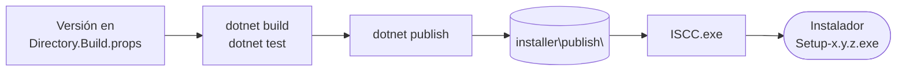

# Compilar y publicar

De la versión en `Directory.Build.props` al instalador:



## Requisitos

- Windows 11 de 64 bits. La aplicación usa APIs de audio de Windows y WPF.
- SDK de **.NET 10**.
- Visual Studio con soporte de .NET 10 y de soluciones `.slnx`, o cualquier editor con la CLI de `dotnet`.

## Estructura de la solución

| Ruta | Contenido |
|---|---|
| `LoopbackTranscriber.slnx` | La solución, con los dos proyectos. |
| `Directory.Build.props` | Versión y analizadores. Afecta a todos los proyectos. |
| `.editorconfig` | Ajustes de las reglas de análisis. |
| `.config\dotnet-tools.json` | DocFX como herramienta local, para esta documentación. |
| `LoopbackTranscriber\` | La aplicación: `WinExe`, `net10.0-windows`, WPF. |
| `LoopbackTranscriber.Tests\` | Los tests: xUnit, `net10.0-windows`, WPF. |
| `installer\` | El script de Inno Setup. Dentro se generan `publish\` (la publicación) y `Output\` (el instalador). |
| `docs\` | Esta documentación, en español e inglés. |
| `LICENSE` | Licencia MIT. |

## Compilar y probar

```powershell
dotnet build LoopbackTranscriber.slnx -c Release
dotnet test  LoopbackTranscriber.slnx -c Release
```

En Visual Studio: *Compilar → Compilar solución* y *Prueba → Ejecutar todas las pruebas*. Hay más detalles en [Tests](tests.md).

## Reglas de calidad

`Directory.Build.props` se aplica a los dos proyectos:

| Propiedad | Valor | Efecto |
|---|---|---|
| `Version` | `1.1.0` | Versión del ensamblado y del ejecutable. El instalador la lee del `.exe`. |
| `EnableNETAnalyzers` | `true` | Analizadores de .NET activados. |
| `AnalysisLevel` | `latest-recommended` | Conjunto recomendado de la última versión. |
| `TreatWarningsAsErrors` | `true` | Cualquier aviso del compilador o de los analizadores **rompe la compilación**. |
| `Deterministic` | `true` | Compilaciones reproducibles. |

`.editorconfig` ajusta algunas reglas:

| Ámbito | Regla | Motivo |
|---|---|---|
| Todo el código | `CA1822.api_surface = private, internal` | Sugiere `static` solo en miembros privados e internos, no en la API pública de los ViewModels, que usan los *bindings*. |
| Todo el código | `CA1716` desactivada | Permite nombres de espacios de nombres y miembros que coinciden con palabras reservadas de otros lenguajes. |
| Tests | `CA1707` desactivada | Nombres de test con guiones bajos: `Metodo_Situacion_Resultado`. |
| Tests | `CA1861` desactivada | Arrays constantes como argumentos en los tests. |
| Tests | `CA2255` desactivada | Permite el `[ModuleInitializer]` que prepara el entorno de los tests. |

Además, cada compilación ejecuta la [comprobación de localización](../architecture/localization.md): una clave inexistente o una traducción que falta es un error.

## Detalles del proyecto

- `App.xaml` se compila como `Page`, no como `ApplicationDefinition`, para usar el `Program.Main` propio que atiende a los [procesos auxiliares](../architecture/workers.md).
- `InternalsVisibleTo LoopbackTranscriber.Tests`: los tests acceden a los tipos `internal`, como los filtros o el protocolo de los *workers*.
- `THIRD-PARTY-NOTICES.txt` se copia a la salida y a la publicación.
- Ajustes de ejecución: GC no concurrente, `TieredPGO` desactivado y `System.GC.ConserveMemory = 5`. Ver [Visión general](../architecture/overview.md).

## Publicar

El perfil `Properties\PublishProfiles\FolderProfile.pubxml` es el que usa el instalador:

| Propiedad | Valor |
|---|---|
| Configuración | `Release` |
| `RuntimeIdentifier` | `win-x64` |
| `SelfContained` | `true`: incluye el *runtime* de .NET, no hace falta instalarlo |
| `PublishSingleFile` | `false`: las bibliotecas nativas de Whisper y LLama van como ficheros |
| `PublishReadyToRun` | `false` |
| `PublishDir` | `..\installer\publish\` |

```powershell
dotnet publish LoopbackTranscriber\LoopbackTranscriber.csproj -p:PublishProfile=FolderProfile
```

O, en Visual Studio: clic derecho en el proyecto → *Publicar* → *FolderProfile*.

El paso siguiente es generar el [instalador](installer.md).

## Cambiar la versión

1. Cambia `<Version>` en `Directory.Build.props`.
2. Publica.
3. Compila el instalador. Toma la versión del `LoopbackTranscriber.exe` publicado, así que no hay que tocarlo.
