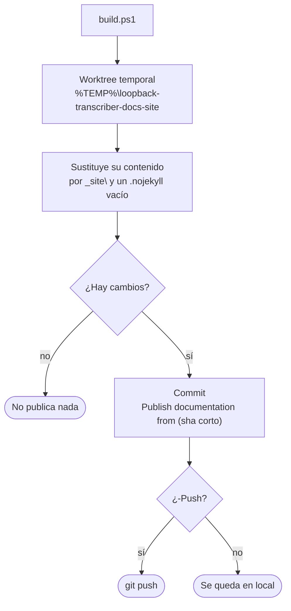

# Documentación

Esta documentación se genera con **DocFX** en **español e inglés**. Las fuentes viven en `docs\` de la rama `main`. El HTML generado se publica en la rama **`docs-site`**, que GitHub Pages sirve como web estática.

## Estructura

| Ruta | Contenido |
|---|---|
| `.config\dotnet-tools.json` | DocFX como herramienta local, con versión fijada. |
| `docs\index.html` | Portada raíz: redirige a `es\` o `en\`. |
| `docs\template\public\main.js` | Enlace para cambiar de idioma y colores de los diagramas. |
| `docs\template\public\main.css` | Estilos de la portada, de las páginas y de los diagramas. |
| `docs\template-es\token.json` | Textos de la plantilla en español («En este artículo», «Siguiente», avisos…). Solo lo usa la versión en español. |
| `docs\images\` | Logo y favicon, comunes a los dos idiomas. |
| `docs\build.ps1` | Genera la web completa en `docs\_site\`. |
| `docs\publish.ps1` | La genera y la publica en `docs-site`. |
| `docs\.gitignore` | Excluye `_site\` y `obj\`. |
| `docs\es\`, `docs\en\` | Cada versión del sitio. |

Cada idioma (`es\` y `en\`) tiene la misma estructura y los **mismos nombres de fichero**:

| Ruta | Contenido |
|---|---|
| `docfx.json` | Construcción de ese idioma. |
| `toc.yml` | Menú superior. |
| `index.md` | Portada. |
| `guide\` | Guía de uso. |
| `architecture\` | Cómo funciona por dentro. |
| `development\` | Compilar, tests, instalador y esta página. |

El enlace de cambio de idioma sustituye `/es/` por `/en/` en la dirección actual, o al revés, así que lleva a la misma página en el otro idioma. Por eso una página debe llamarse igual en los dos. El idioma elegido se recuerda en el navegador. La portada raíz lo usa y, la primera vez, elige según el idioma del navegador: español si empieza por `es`, inglés en los demás casos.

## Generar y ver en local

Desde la raíz del repositorio:

```powershell
.\docs\build.ps1 -Serve
```

Abre <http://localhost:8080>. El script:

1. restaura DocFX en la versión fijada en `.config\dotnet-tools.json` (`dotnet tool restore`);
2. **`docfx build`** de `es\` y de `en\`: cada uno genera `docs\_site\es\` y `docs\_site\en\` con la plantilla `modern`, búsqueda y su idioma (`_lang`);
3. borra los mapas de depuración de JavaScript (`*.map`) que copia la plantilla: ocupan unos 37 MB, la web no los usa y hacían que la publicación en GitHub Pages superara el tiempo máximo;
4. copia `index.html` a `docs\_site\`;
5. con `-Serve`, sirve `docs\_site\`.

No compila ni analiza el código: solo necesita el SDK de .NET para ejecutar DocFX.

Sin `-Serve` solo genera la web.

Los diagramas son bloques ` ```mermaid `, que la plantilla `modern` dibuja en el navegador.

## Publicar en GitHub Pages

### Una vez: la rama `docs-site`

La rama debe ser **huérfana**, sin historial compartido con `main`, para que solo contenga el HTML. Si ya existe una `docs-site` creada a partir de `main`, bórrala primero:

```powershell
git push origin --delete docs-site
git branch -D docs-site
```

No hace falta crearla a mano: si no existe, `publish.ps1` la crea huérfana en una carpeta temporal, sin tocar tu copia de trabajo.

### Cada vez que cambie la documentación

```powershell
.\docs\publish.ps1 -Push
```



Si la rama `docs-site` no existe, el *worktree* la crea huérfana. Al terminar, el *worktree* se elimina siempre. El `.nojekyll` evita que GitHub Pages procese el sitio con Jekyll, que quitaría los ficheros y carpetas que empiezan por `_`.

Sin `-Push` solo hace el commit local, para revisarlo antes con `git log docs-site`. Con `-Branch otra-rama` publica en otra rama.

### Una vez: activar GitHub Pages

En GitHub, *Settings → Pages → Build and deployment*:

- **Source**: *Deploy from a branch*;
- **Branch**: `docs-site`, carpeta `/ (root)`, y *Save*.

En uno o dos minutos la web estará en `https://pgomur.github.io/loopback-transcriber/`, que redirige a `…/es/` o `…/en/`.

> [!NOTE]
> GitHub Pages es gratuito en repositorios públicos. En uno privado requiere un plan de pago, y la web publicada es pública igualmente, salvo en GitHub Enterprise Cloud.

## Escribir páginas

- Markdown de DocFX: tablas, bloques de código, `mermaid` y avisos `> [!NOTE]`, `> [!TIP]`, `> [!IMPORTANT]` y `> [!WARNING]`.
- Los enlaces entre páginas son relativos y apuntan al `.md`: `[Fiabilidad](../architecture/reliability.md)`. DocFX avisa si alguno no existe.
- **Cada cambio se hace en los dos idiomas** y en el mismo commit: el mismo fichero en `es\` y en `en\`, con el mismo nombre. Una página nueva se añade a los dos `toc.yml` de su carpeta.
- Si cambia el comportamiento de una parte del código, actualiza su página de Arquitectura en el mismo commit. Esta documentación describe valores concretos, como umbrales, tiempos y rutas, y se queda desfasada si no se mantiene.
