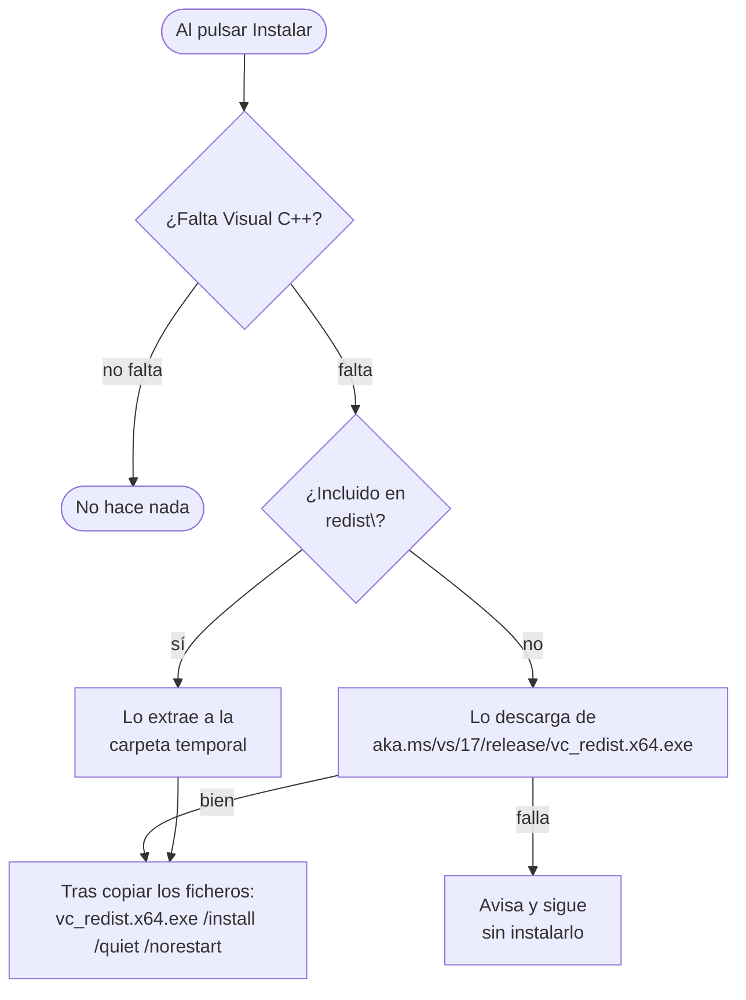

# Instalador

El instalador se genera con **Inno Setup 6** a partir de `installer\LoopbackTranscriber.iss`. Usa funciones de la versión 6.3 o posteriores, como `x64compatible` y la página de descargas.

## Generarlo

1. [Publica](building.md#publicar) la aplicación en `installer\publish\`.
2. Opcional: copia `vc_redist.x64.exe` en `installer\redist\` para incluirlo en el instalador y no depender de la descarga. La carpeta está en `.gitignore`.
3. Compila el script con `ISCC.exe installer\LoopbackTranscriber.iss` (por defecto en `C:\Program Files (x86)\Inno Setup 6\`), o ábrelo en el IDE de Inno Setup y pulsa *Compile*.
4. El resultado es `installer\Output\LoopbackTranscriberSetup-<versión>.exe`.

Si no existe `publish\LoopbackTranscriber.exe`, la compilación se detiene con un error explicándolo.

## Qué hace el script

### Versión

Se lee del ejecutable publicado con `GetVersionComponents`:

- `AppVersion` y el nombre del fichero usan `Mayor.Menor.Revisión`, por ejemplo `1.1.0`;
- `VersionInfoVersion` usa los cuatro componentes.

Así la versión solo se define en `Directory.Build.props`.

### Instalación

| Ajuste | Valor |
|---|---|
| `AppId` | `{B6E1F6C4-6E8B-4A6E-9C2A-6C7B9A9E9C3D}`. No debe cambiar: identifica la aplicación para actualizar y desinstalar. |
| Destino | `{autopf}\LoopbackTranscriber` |
| Arquitectura | solo x64, instalación en modo de 64 bits |
| Versión mínima de Windows | `10.0.22000` (Windows 11) |
| Idiomas del asistente | español, inglés, portugués de Brasil, alemán y ruso. Pregunta el idioma solo si no coincide con el de Windows y recuerda el de la instalación anterior. |
| Estilo del asistente | moderno, con el icono de la aplicación |
| Compresión | LZMA2 *ultra64* sólida |
| `AppMutex` | `Local\LoopbackTranscriber-B6E1F6C4-…`, el mismo mutex de instancia única que usa la aplicación. El asistente detecta si está abierta y ofrece cerrarla (`CloseApplications`). No la vuelve a abrir sola. |
| `SetupMutex` | Impide ejecutar dos instaladores a la vez. |
| Accesos directos | menú Inicio, y escritorio opcional (desmarcado) |
| Al terminar | ofrece abrir la aplicación |

### Ficheros

Copia todo `publish\` **excepto** lo que no se usa en Windows x64:

- *runtimes* de `linux-x64`, `vulkan\linux-x64`, `win-arm64` y `win-x86`;
- recursos satélite de idiomas que la aplicación no tiene: `cs`, `fr`, `it`, `ja`, `ko`, `pl`, `tr`, `zh-Hans`, `zh-Hant`.

La sección `[InstallDelete]` borra esas mismas carpetas si quedaron de una instalación anterior.

### Visual C++ Redistributable

Whisper.net y LLamaSharp necesitan el *runtime* de Visual C++ 2015-2022 x64.

`VCRedistMissing()` considera que está instalado si en `HKLM64\SOFTWARE\Microsoft\VisualStudio\14.0\VC\Runtimes\x64` hay `Installed = 1` y `Minor ≥ 30`.

El código de salida del instalador de Visual C++ decide qué pasa después:

| Código | Significado | Reacción |
|---|---|---|
| `0` | Instalado | — |
| `1638` | Ya había una versión igual o más nueva | — |
| `1641`, `3010` | Necesita reiniciar | El asistente ofrece reiniciar al terminar. |
| Otro | Error | Avisa con el código y el enlace para instalarlo a mano. |

### Desinstalación

Tras desinstalar, si existe `%LocalAppData%\LoopbackTranscriber`, pregunta si borrar también los datos: ajustes, transcripciones, modelos y grabaciones sin procesar. La respuesta por defecto es **No**. Si se acepta, borra esa carpeta y `%TEMP%\LoopbackTranscriber`. Las carpetas que el usuario haya cambiado en Configuración no se tocan. En una desinstalación silenciosa no pregunta ni borra nada.
