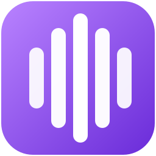

  

    

      
      

        <h1>LoopbackTranscriber</h1>
        
Aplicación de escritorio para Windows · Código abierto (MIT)

      

    

    
Graba, transcribe y resume tus reuniones sin que nada salga de tu equipo.

    
Graba el audio de una aplicación concreta (Teams, Zoom, Meet en el navegador…) junto con tu micrófono. Después lo transcribe con Whisper, distingue lo que dices tú de lo que dicen los demás y, cuando se lo pides, genera un resumen con un modelo de lenguaje. Mientras grabas, también puede mostrar la reunión traducida en una ventana flotante.

    

      <a class="lt-button lt-button-primary" href="guide/getting-started.md">Primeros pasos</a>
      <a class="lt-button lt-button-secondary" href="architecture/overview.md">Cómo funciona por dentro</a>
      <a class="lt-button lt-button-secondary" href="https://github.com/pgomur/loopback-transcriber">GitHub</a>
    

  

  <aside class="lt-facts">
    <ul class="lt-facts-list">
      <li>
        <i class="bi bi-windows"></i>
        

          Sistema
          Windows 11 de 64 bits
          10.0.22000 o superior
        

      </li>
      <li>
        <i class="bi bi-gpu-card"></i>
        

          Aceleración
          GPU con Vulkan
          Sin ella, CPU (más lento)
        

      </li>
      <li>
        <i class="bi bi-soundwave"></i>
        

          Transcripción
          Whisper large-v3-turbo
          Modelo de ~624 MB
        

      </li>
      <li>
        <i class="bi bi-stars"></i>
        

          Resumen y traducción
          Qwen3-4B
          Modelo de ~2,5 GB
        

      </li>
      <li>
        <i class="bi bi-cloud-arrow-down"></i>
        

          Conexión
          Solo al descargar modelos
          El resto, en tu equipo
        

      </li>
      <li>
        <i class="bi bi-code-slash"></i>
        

          Hecha con
          WPF · .NET 10
          Patrón MVVM
        

      </li>
      <li class="lt-fact-wide">
        <i class="bi bi-translate"></i>
        

          Idiomas
          ES EN PT DE RU
          Interfaz, reuniones (o detección automática) y traducción
        

      </li>
    </ul>
  </aside>

  <h2 class="lt-section-title">Cómo se usa</h2>
  
<strong>Opcional:</strong> abre la <a href="guide/live-translation.md">traducción en vivo</a> para seguir la reunión traducida mientras grabas.

<ol class="lt-steps">
  <li>
    <h3>Elige la aplicación</h3>
    
Teams viene de serie. Zoom, el navegador u otras se añaden en <strong>Aplicaciones</strong>.

    <a class="lt-step-link" href="guide/applications.md">Ver en la guía</a>
  </li>
  <li>
    <h3>Graba</h3>
    
Pulsa <strong>Iniciar grabación</strong> (o usa el icono de la bandeja). Se graban a la vez la aplicación, la salida de audio predeterminada y tu micrófono.

    <a class="lt-step-link" href="guide/recording.md">Ver en la guía</a>
  </li>
  <li>
    <h3>Obtén la transcripción</h3>
    
Al pulsar <strong>Detener grabación</strong>, Whisper la transcribe y, si se grabó tu micrófono, separa <strong>Participantes</strong> y <strong>Tú</strong>. Se guarda en el historial.

    <a class="lt-step-link" href="guide/transcripts.md">Ver en la guía</a>
  </li>
  <li>
    <h3>Resume</h3>
    
En la pestaña <strong>Resumen IA</strong>, pulsa <strong>Resumir</strong>: título, puntos clave, objetivos y próximos pasos.

    <a class="lt-step-link" href="guide/transcripts.md">Ver en la guía</a>
  </li>
</ol>

  <h2 class="lt-section-title">Funciones</h2>
  
Cada función enlaza a su guía de uso y a su explicación técnica.

  

    <h3>Grabación por aplicación</h3>
    
Solo el audio del programa elegido, más tu micrófono en una pista aparte. Si esa pista sale en silencio, usa la salida de audio predeterminada.

    
<a href="guide/recording.md">Guía</a> · <a href="architecture/audio-capture.md">Técnica</a>

  

  

    <h3>Cualquier aplicación</h3>
    
Teams viene de serie. Añade Zoom, Discord o el navegador (para Meet) entre los procesos que están reproduciendo audio.

    
<a href="guide/applications.md">Guía</a> · <a href="architecture/audio-capture.md">Técnica</a>

  

  

    <h3>Transcripción con Whisper</h3>
    
Whisper <code>large-v3-turbo</code>, en GPU Vulkan si la hay. Idioma fijo o detección automática. Filtra alucinaciones, repeticiones y eco.

    
<a href="guide/settings.md">Guía</a> · <a href="architecture/processing.md">Técnica</a>

  

  

    <h3>Quién habla</h3>
    
Tu micrófono se transcribe aparte y se alinea con la reunión. Cada párrafo indica <strong>Participantes</strong> o <strong>Tú</strong>, con tu nombre delante si lo has configurado.

    
<a href="guide/recording.md">Guía</a> · <a href="architecture/processing.md">Técnica</a>

  

  

    <h3>Historial y búsqueda</h3>
    
Busca en título, aplicación, fecha, resumen y texto completo, sin distinguir mayúsculas ni tildes. Filtra por fechas y duración, y vuelve a transcribir con los ajustes actuales.

    
<a href="guide/transcripts.md">Guía</a> · <a href="architecture/data-on-disk.md">Técnica</a>

  

  

    <h3>Resumen con IA</h3>
    
Qwen3-4B escribe título, propósito, puntos clave, temas, objetivos y próximos pasos, en el idioma de la aplicación.

    
<a href="guide/transcripts.md">Guía</a> · <a href="architecture/summary.md">Técnica</a>

  

  

    <h3>Traducción en vivo</h3>
    
Ventana flotante con lo que dicen los participantes y su traducción a español, inglés, portugués, alemán o ruso.

    
<a href="guide/live-translation.md">Guía</a> · <a href="architecture/live-translation.md">Técnica</a>

  

  

    <h3>Sin pérdidas</h3>
    
Si algo falla (un error, un cierre, un apagado o un cuelgue), el audio se conserva como grabación sin procesar para reintentarlo.

    
<a href="guide/recording.md">Guía</a> · <a href="architecture/reliability.md">Técnica</a>

  

  <h2 class="lt-section-title">Privacidad y datos</h2>
  
Qué usa internet y dónde quedan tus ficheros.

  

    <h3>Todo se queda en tu equipo</h3>
    
El audio, las transcripciones y los resúmenes no salen de él. La aplicación solo se conecta a internet para descargar los dos modelos, desde una revisión fija de Hugging Face y comprobando su SHA256. El instalador puede descargar además Microsoft Visual C++ Redistributable si falta en el equipo.

    
Graba solo con el consentimiento de las personas que participan.

    
<a href="architecture/models.md">Modelos e integridad</a>

  

  

    <h3>Dónde se guarda todo</h3>
    
En <code>%LocalAppData%\LoopbackTranscriber</code>: ajustes, modelos, transcripciones, grabaciones sin procesar y registro. Las carpetas de modelos y de transcripciones se pueden cambiar en Configuración.

    
Cada grabación es una carpeta con el texto en Markdown (<code>.md</code>) y el audio (<code>.wav</code>), y, si los hay, tu micrófono (<code>_mic.wav</code>) y el resumen (<code>.summary.json</code>).

    
<a href="architecture/data-on-disk.md">Datos en disco</a>

  

  <h2 class="lt-section-title">Toda la documentación</h2>

  

    <h3>Guía de uso</h3>
    <ul class="lt-doc-list">
      <li><a href="guide/getting-started.md">Primeros pasos</a></li>
      <li><a href="guide/recording.md">Grabar una reunión</a></li>
      <li><a href="guide/transcripts.md">Transcripciones y resúmenes</a></li>
      <li><a href="guide/live-translation.md">Traducción en vivo</a></li>
      <li><a href="guide/applications.md">Aplicaciones</a></li>
      <li><a href="guide/settings.md">Configuración</a></li>
      <li><a href="guide/troubleshooting.md">Solución de problemas</a></li>
    </ul>
  

  

    <h3>Arquitectura</h3>
    <ul class="lt-doc-list">
      <li><a href="architecture/overview.md">Visión general</a></li>
      <li><a href="architecture/startup.md">Arranque y cierre</a></li>
      <li><a href="architecture/viewmodels.md">ViewModels y mensajería</a></li>
      <li><a href="architecture/audio-capture.md">Captura de audio</a></li>
      <li><a href="architecture/processing.md">Procesado de una grabación</a></li>
      <li><a href="architecture/summary.md">Resumen</a></li>
      <li><a href="architecture/live-translation.md">Traducción en vivo</a></li>
      <li><a href="architecture/workers.md">Procesos auxiliares</a></li>
      <li><a href="architecture/models.md">Modelos e integridad</a></li>
      <li><a href="architecture/reliability.md">Fiabilidad</a></li>
      <li><a href="architecture/localization.md">Localización</a></li>
      <li><a href="architecture/data-on-disk.md">Datos en disco</a></li>
    </ul>
  

  

    <h3>Desarrollo</h3>
    <ul class="lt-doc-list">
      <li><a href="development/building.md">Compilar y publicar</a></li>
      <li><a href="development/tests.md">Tests</a></li>
      <li><a href="development/installer.md">Instalador</a></li>
      <li><a href="development/documentation.md">Documentación</a></li>
    </ul>
  

